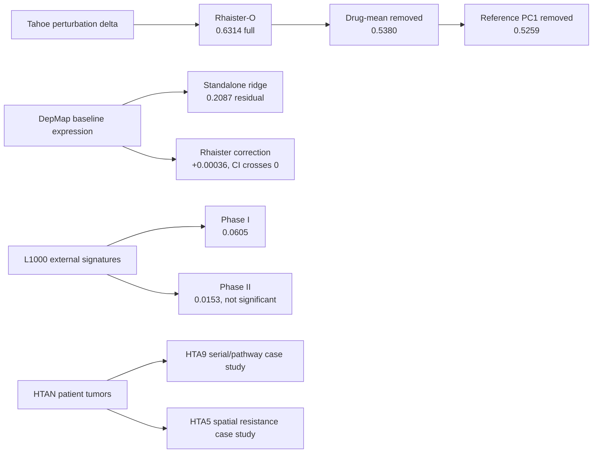

# Weekly Results Report — 2026-09-11

**Reporting window:** project inception through the Friday 2026-09-11 meeting  
**Scope:** Tahoe-100M strict unseen-cell-line prediction, DepMap context,
LINCS L1000 external comparison, and an HTAN/other-dataset feasibility audit  
**Result policy:** positive and negative results are retained. Values below are
condition- or line-level summaries; individual cells are not treated as
independent replicates.

## 1. Executive results

| Question | Result | Evidence-level conclusion |
|---|---|---|
| Does a prior model exist for strict unseen Tahoe cell lines? | Yes. Rhaister-O uses target-line DMSO plus treatment responses from reference lines. Our compact reproduction obtained mean split Pearson `0.631456 ± 0.067988`. | Rhaister-O is the frozen primary baseline. |
| Is its score only a transferable drug-average effect? | No. Pearson remained `0.537951` after subtracting the reference drug-dose mean. | There is substantial line-specific residual signal. |
| Is its score only a generic line response template? | No. Reference-only PC1 removal left Pearson `0.525927`; PC1 explained only `4.90–5.49%` of reference residual variance. | The aggregate result survives two component-removal controls, although line performance is heterogeneous. |
| Does nearest untreated/DMSO expression solve the task? | No. Fixed 1NN and 3NN achieved `0.298532` and `0.340531` on full delta, respectively. | Baseline-expression proximity alone is insufficient. |
| Does DepMap baseline expression improve Rhaister-O? | No stable improvement. The correction changed drug-residual Pearson from `0.539430` to `0.539787` (`+0.000357`, 95% line-bootstrap CI `[-0.002679, 0.003610]`). | The predeclared modality/MLP expansion gate failed. |
| Does L1000 independently agree with Tahoe? | Phase I showed weak 79-gene concordance (`r=0.060522`); Phase II did not replicate it (`r=0.015311`). | Useful as a stress test, not a strong direct training signal. |
| Can HTA5/HTA9 directly validate drug-response prediction? | No standardized DMSO-versus-drug matrix exists. HTA9 nevertheless has strong serial-biopsy structure; HTA5 has treatment-resistance and spatial data. | HTAN can support retrospective patient/pathway consistency analyses, not direct gene-level Rhaister-O validation. |

## 2. Data prepared and frozen

| Resource | Frozen local content | Key dimensions/coverage | Role |
|---|---|---|---|
| Tahoe-100M | Official metadata, one raw sparse-expression smoke shard, compact Cell-Eval/Rhaister derivative | 50 observed lines, 379 compounds, three doses (`0.05`, `0.5`, `5 µM`), 14 plates; compact cache `56,827 × 2,000`; DMSO `700 × 2,000` | Supervised perturbation atlas and primary evaluation |
| Rhaister | Code commit `75fed20a...`; data revision `c7963cf3...`; five released complete-line splits | 25 outer test lines, 19,268 test conditions in aggregate, fixed 2,000 genes | Strict unseen-line baseline |
| DepMap Public 24Q4 | Checksum-verified raw modalities and Tahoe-matched subsets | Baseline expression for 47 Tahoe lines and 19,193 genes; 23/25 Rhaister test lines covered | Independent, pre-treatment cell-context covariates |
| LINCS L1000 Phase I | Official metadata and Level-5 GCTX | `473,647 × 12,328`; final exact comparison has 171 Tahoe conditions, 97 drugs, 3 lines | External cross-platform comparison |
| LINCS L1000 Phase II | Official metadata and Level-5 GCTX | `118,050 × 12,328`; final exact comparison has 304 Tahoe conditions, 78 drugs, 3 lines | Replication comparison |
| Primary literature | Ten checksum-pinned PDFs | Tahoe, Rhaister, State, Tahoe-x1, SCALE, response decomposition, and neighboring models | Prior-art and protocol interpretation |

Bulk data and generated matrices reside under
`/nfs-stor/yuqi.lei/Therapeutic`; the project tree contains code, manifests, and
reports only.

**Treatment-count audit.** The Tahoe paper reports 1,135 drug-dose
combinations, whereas the frozen compact Rhaister derivative contains 1,137
distinct treatment labels—the nominal `379 compounds × 3 doses`. Its maximum
complete grid is therefore `50 × 1,137 = 56,850` line-treatment responses;
56,827 are observed, leaving 23 absent combinations. These are treated
pseudobulk delta conditions, not individual cells. Before condition-level
aggregation there are 65,218 plate rows; plate-matched DMSO centroids are held
separately as `700 × 2,000`. Dataset-paper and compact-derivative counts must
be cited with their respective definitions.

## 3. Strict unseen-cell-line Rhaister-O results

### 3.1 All 25 held-out lines

The same fixed 2,000-gene panel and complete-cell-line outer splits were used
for every model. “Drug residual” subtracts the drug-dose mean estimated only
from reference lines. “PC1 removed” additionally removes a generic residual
template learned only from reference-line outcomes.

| Predictor | Full delta Pearson | Drug-mean-residual Pearson | Reference-PC1-removed Pearson |
|---|---:|---:|---:|
| Drug-dose mean | 0.443354 | 0.000000 | -0.002800 |
| Fixed nearest-DMSO line (1NN) | 0.298532 | 0.147200 | 0.128200 |
| Fixed nearest-DMSO lines (3NN) | 0.340531 | 0.138800 | 0.117400 |
| **Rhaister-O** | **0.631400** | **0.537951** | **0.525927** |

All 25 per-line drug-cluster bootstrap intervals for Rhaister-O remained above
zero after both component-removal diagnostics. This does not remove the strong
heterogeneity: PC1-removed per-line Pearson ranged from `0.064848` to
`0.684987`.

### 3.2 Released outer splits

| Split | Drug mean, full | Rhaister-O, full | Rhaister-O, drug residual | Rhaister-O, PC1 removed |
|---:|---:|---:|---:|---:|
| 5 | 0.4807 | 0.6853 | 0.5754 | 0.5692 |
| 6 | 0.3704 | 0.5677 | 0.5095 | 0.5004 |
| 7 | 0.5413 | 0.7139 | 0.5746 | 0.5555 |
| 8 | 0.4697 | 0.6531 | 0.5543 | 0.5439 |
| 9 | 0.3546 | 0.5369 | 0.4759 | 0.4606 |

The compact reproduction's unrounded mean full-delta Pearson was `0.631456`
with between-split standard deviation `0.067988`, matching the paper's rounded
`0.63`. Its diagonal treatment-specific path covered 19,185/19,268 test
conditions (`99.57%`); the remaining conditions used the additive fallback.

## 4. DepMap-expression experiments

DepMap Public 24Q4 expression covered 23 of the 25 outer-held-out lines. C3A
and COLO 205 were reported missing rather than imputed.

### 4.0 Input/output gene audit

The DepMap expression input has 19,193 unique protein-coding gene symbols. Of
the fixed 2,000 Tahoe/Rhaister output genes, 1,987 (`99.35%`) have an exact
symbol match in the DepMap expression columns; 13 do not: `ABTB3`, `CFAP107`,
`CFAP95`, `DEFB113`, `DYNLT5`, `HYCC1`, `MROH5`, `NALF1`, `OR1P1`, `OR8J2`,
`PRSS51`, `PTCHD3`, and `SPDYE15`.

This overlap is an audit, not a preprocessing filter in the current model.
PCA uses all 19,193 DepMap genes as the input feature space, while the
multi-output ridge predicts all 2,000 Tahoe genes as a separate output space.
Only the cell-line rows must be aligned for this supervised mapping. The
parsed identifiers are in
`/nfs-stor/yuqi.lei/Therapeutic/derived/depmap_24q4/gene_columns.csv`; DepMap raw
columns retain both symbol and Entrez ID, for example `TSPAN6 (7105)`.

### 4.1 Standalone residual ridge

| Model on the same 23 lines | Full delta Pearson | Drug-residual Pearson | PC1-removed Pearson |
|---|---:|---:|---:|
| DepMap-expression residual ridge | 0.4732 | 0.2087 | 0.1803 |
| Frozen Rhaister-O | 0.6344 | 0.5394 | 0.5271 |

The DepMap ridge exceeded its small permutation null on the drug-residual task:
line-bootstrap 95% CI `[0.1591, 0.2601]`, permutation 95th percentile `0.0304`.
This is a real but much weaker signal than the perturbation-transfer baseline.

### 4.2 Cross-fitted correction to Rhaister-O

| Metric | Frozen Rhaister-O | Corrected | Difference | 95% line-bootstrap CI of difference |
|---|---:|---:|---:|---:|
| Full delta | 0.634447 | 0.636036 | +0.001589 | [-0.000286, 0.003819] |
| Drug residual | 0.539430 | 0.539787 | +0.000357 | [-0.002679, 0.003610] |
| PC1 removed | 0.527100 | 0.527491 | +0.000392 | [-0.002850, 0.003983] |

Only 10/23 lines improved in point estimate. Eight lines had positive
condition-bootstrap intervals, 13 had negative intervals, and two crossed
zero. The post hoc largest gains were HCT15 `+0.02144` and LS180 `+0.01648`;
the largest losses were SW1271 `-0.01319` and PANC1 `-0.00809`. These line
examples are descriptive, not predeclared subgroup tests.

**Gate result: false.** The evidence does not support adding DepMap CNV,
mutation, dependency, or an MLP under the current protocol.

### 4.3 DepMap-to-pseudo-DMSO feasibility audit

Directly substituting DepMap expression for the Rhaister-O query baseline is
not valid. Rhaister-O was calibrated on Tahoe DMSO centroids: the released
table is `700 × 2,002`, comprising 50 lines by 14 plates, two identifier
columns, and the fixed 2,000 genes. The executable model applies `log1p`,
aggregates these plate-derived controls by line, and centers them using the
outer reference lines. DepMap instead supplies bulk `TPM log1p` on 19,193
genes from a different platform.

The 47 shared expression-covered lines make a cross-platform bridge feasible
as a new experiment: learn `DepMap baseline → Tahoe-DMSO log1p feature` on
outer reference lines, predict a 2,000-dimensional pseudo-DMSO feature for an
outer query line, and pass only that predicted query feature to frozen
Rhaister-O. This design has not been run. It would answer a stricter question—
response prediction for a line with DepMap baseline but no Tahoe control—and
must be evaluated by outer-line cross-fitting before being applied to
DepMap-only lines.

## 5. LINCS L1000 external comparison

### 5.1 Identity and feature overlap audit

The matched labels represent the same catalogue cell-line identity, not the
same physical cells, passage, clone, culture batch, or experimental well.

| Quantity | Phase I | Phase II |
|---|---:|---:|
| Initial normalized Tahoe line-name matches | 7 | 3 |
| Final exact lines after time/dose/drug filters | 3 | 3 |
| Final lines | A549, HT29, HS578T | A549, HT29, HS578T |
| Tahoe drugs matched by any key | 157 | 147 |
| Structure-validated drug matches | 131 | 79 |
| Drugs in final experiment | 97 | 78 |
| Exact Tahoe conditions | 171 | 304 |
| Selected Level-5 signatures | 199 | 332 |

Of the 978 L1000 landmark genes, 946 exist in the full Tahoe gene universe.
The released Rhaister 2,000-gene panel intersects the distributed L1000 matrix
in 1,365 rows. Only 79 of these are directly measured L1000 landmarks; 997 are
L1000-inferred BING genes, and another 289 are inferred non-BING genes.
Consequently, the 79-gene panel is the primary cross-platform comparison.

### 5.2 Concordance results

| Result | Phase I | Phase II |
|---|---:|---:|
| Drug-macro Pearson, 79 direct landmarks | 0.060522 | 0.015311 |
| Drug-bootstrap 95% CI | [0.035959, 0.085890] | [-0.004086, 0.035060] |
| Drug-permutation 95th percentile | 0.0413 | 0.0172 |
| Drug-permutation p-value | 0.001996 | 0.107784 |
| Drug-macro Spearman | 0.0524 | 0.0285 |
| Sign accuracy | 0.5191 | 0.5079 |

Phase I and II L1000 signatures correlated at only `0.2025` over 31 shared
conditions (13 drugs), demonstrating substantial platform/phase variability.

For the one aligned HS578T Tahoe case study:

| Phase | Conditions / drugs | Direct L1000 transfer | Tahoe drug mean | Rhaister-O |
|---|---:|---:|---:|---:|
| I | 33 / 11 | 0.0577 | 0.6814 | 0.8437 |
| II | 16 / 6 | 0.0408 | 0.6822 | 0.8597 |

The external L1000 signal is therefore far weaker than an in-platform Tahoe
baseline. It should not be interpreted as evidence that direct L1000/Tahoe
matrix concatenation is valid.

## 6. HTAN feasibility audit: HTA5 and HTA9

The audit used the public HTAN Data Portal V8.0 (portal last updated
2026-08-03) and its current public metadata tables on 2026-09-11. Counts may
change with future releases. “Data-file records” below use the portal's unique
data-file identifier convention and are not counts of unique biological
specimens.

### 6.1 Cohorts and longitudinal structure

| Property | HTA5 — DFCI | HTA9 — OHSU |
|---|---|---|
| Atlas focus | Cellular geography of therapeutic resistance across breast cancer, melanoma, and colon cancer, sampled around therapy | Omic and multidimensional spatial atlas of metastatic breast cancer, including endocrine/CDK4/6 and PARP/immunomodulatory treatment contexts |
| Participants in current cases table | 156 | 33 |
| Unique linked biospecimens | 896 from 133 participants | 1,866 from all 33 participants |
| Dominant tissue context | 746 metastatic biospecimens from 125 participants | 1,790 metastatic biospecimens from 33 participants |
| Longitudinal labels | Pre-treatment, on-treatment, post-treatment, germline | Biopsy 1–5, blood draw, primary resection |
| Participants with atlas-wide pre and post biospecimens | 8 | Not applicable to its numbered-biopsy convention |
| Participants with >1 nonempty timepoint | Not used because labels are pre/post | 32/33 |

HTA5 diagnosis counts were malignant melanoma 63, carcinoma NOS 59,
adenocarcinoma NOS 29, small-cell carcinoma 3, and squamous-cell carcinoma 2.
HTA9 was predominantly infiltrating duct carcinoma (18) or duct carcinoma NOS
(12), with three other single cases.

### 6.2 Current portal data-file records by assay and level

| Center | Assay | L1 | L2 | L3 | L4 | Unknown |
|---|---|---:|---:|---:|---:|---:|
| HTA5 | Bulk DNA | — | 227 | 114 | — | — |
| HTA5 | CODEX | — | 32 | — | — | — |
| HTA5 | Imaging | — | — | 69 | 69 | — |
| HTA5 | MERFISH | — | 16,528 | — | — | — |
| HTA5 | MxIF | — | 113 | — | — | — |
| HTA5 | scRNA-seq | 304 | 24 | 32 | 48 | — |
| HTA9 | Bulk DNA | 511 | 141 | 210 | — | — |
| HTA9 | Bulk RNA-seq | 162 | 65 | 70 | — | — |
| HTA9 | CyCIF | — | 144 | 375 | 321 | — |
| HTA9 | Electron microscopy | 74,252 | 36,073 | 32 | 41 | — |
| HTA9 | Imaging | — | — | 190 | 290 | — |
| HTA9 | GeoMx | — | 77 | 46 | — | — |
| HTA9 | RPPA | — | 26 | 26 | 26 | — |
| HTA9 | mIHC | — | 335 | 84 | — | — |
| HTA9 | scATAC-seq | 66 | 33 | 38 | — | — |
| HTA9 | scDNA-seq | 1,615 | 1,271 | — | — | 11 |
| HTA9 | scRNA-seq | 100 | 13 | 13 | — | — |

Processed/open candidates found in the portal include 48 HTA5 scRNA Level-4
HDF5/H5AD records, 13 HTA9 scRNA Level-3 HDF5 records, 70 HTA9 bulk-RNA
Level-3 TSV records, 46 HTA9 GeoMx Level-3 CSV records, and 38 HTA9 scATAC
Level-3 BED/TSV records. Raw FASTQ/BAM access generally requires dbGaP;
processed Synapse-hosted objects can require an authenticated Synapse account.

### 6.3 Assay-linked biological coverage

| Center/assay | Linked biospecimens | Linked participants | Portal-visible within-assay longitudinal pairing |
|---|---:|---:|---|
| HTA5 scRNA-seq | 109 | 104 | 0/104 participants linked to both pre and post files |
| HTA5 MERFISH | 41 | 38 | 0/38 linked to both pre and post files |
| HTA9 scRNA-seq | 13 | 8 | 5/8 have both biopsy 1 and 2 |
| HTA9 bulk RNA-seq | 68 | 32 | 27/32 have both biopsy 1 and 2 |
| HTA9 GeoMx | 77 | 31 | 23/31 have both biopsy 1 and 2 |
| HTA9 scATAC-seq | 26 | 17 | 8/17 have both biopsy 1 and 2 |
| HTA9 scDNA-seq | 11 | 4 | 3/4 have both biopsy 1 and 2 |

The apparent absence of HTA5 paired pre/post scRNA or MERFISH files is a
metadata-linkage result, not proof that the underlying processed objects lack
paired samples. Several Level-4 H5AD records have empty or pooled portal
biospecimen fields; `.obs`, therapy metadata, and manifests must be inspected
before a biological conclusion is drawn.

### 6.4 Compatibility result

| Required property | Tahoe/Rhaister task | HTA5 | HTA9 |
|---|---|---|---|
| Standardized vehicle control | Plate-matched DMSO | No | No |
| Standardized compound and dose grid | 379 drugs × 3 doses | No | No |
| Gene-level treatment delta | Directly defined | Potential pre/post contrast, but sparse current linkage | Serial-biopsy contrast, subject to therapy and composition confounding |
| Main biological unit | Cultured cell line condition | Patient tumor and spatial niche | Patient tumor and serial biopsy |
| Direct model benchmarking | Yes | No | No |
| Retrospective pathway/spatial consistency | Secondary | Strong spatial/resistance relevance | Strongest longitudinal/multimodal candidate |

HTA9 is the more actionable HTAN pilot because of its within-patient serial
structure. HTA5 remains valuable for malignant/immune/stromal and spatial
resistance-state analysis. Neither constitutes prospective clinical
validation.

## 7. Other-dataset audit

| Dataset | Perturbation/readout structure | Overlap or bridge to this project | Audit result |
|---|---|---|---|
| sci-Plex | Single-cell transcriptomes after 188 compounds across A549, K562, and MCF7, four doses from 10 nM to 10 µM, approximately 650,000 original profiles | A549 overlaps Tahoe; 24-hour multi-dose drug perturbation is close to the Tahoe design | Best additional transcriptomic perturbation stress test |
| scPerturb | Harmonized collection of 44 single-cell perturbation-response datasets | Common processing layer across heterogeneous chemical/genetic studies | Best portability benchmark; not one coherent experimental design |
| PRISM Repurposing | Viability for 4,518 compounds across hundreds of cell lines in the primary screen; secondary dose-response screen | Uses DepMap cell-line identities and supplies an orthogonal phenotype | Strong downstream functional validation; cannot validate transcript-level predictions directly |
| CTRP v2 | Viability/sensitivity for 481 compounds across 860 cancer cell lines | Broad cell-line/drug overlap and pre-treatment omics | Same orthogonal role as PRISM; not a perturbational transcriptome |
| BeatAML | Patient AML ex-vivo drug sensitivity with genomics; 409 samples in the published coupled sensitivity/omics cohort | Patient-level generalization and treatment-response relevance | Valuable later, but different cancer system and endpoint |
| GDSC | Cancer-cell-line drug sensitivity and baseline molecular features | Additional viability endpoint with line/drug crosswalks | Useful if PRISM/CTRP leave a coverage gap; otherwise redundant initially |

## 8. Result map

No standalone raster/vector plot artifact was generated during this reporting
window; the evidence is presently table-led, with the Mermaid diagram serving
as the first result map.

## 9. Provenance and raw links

### Local result artifacts

| Artifact | Location |
|---|---|
| Rhaister-O baseline report | [`../reports/RHAISTER_O_BASELINE.md`](../reports/RHAISTER_O_BASELINE.md) |
| Signal pilot | [`../reports/RHAISTER_SIGNAL_PILOT.md`](../reports/RHAISTER_SIGNAL_PILOT.md) |
| Ordered 25-line/DepMap experiments | [`../reports/ORDERED_BASELINE_EXPERIMENTS.md`](../reports/ORDERED_BASELINE_EXPERIMENTS.md) |
| Tahoe/DepMap/L1000 synthesis | [`../reports/TAHOE_DEPMAP_L1000_BILINGUAL_SYNTHESIS.md`](../reports/TAHOE_DEPMAP_L1000_BILINGUAL_SYNTHESIS.md) |
| Identity/fusion/deep-learning audit | [`../reports/L1000_TAHOE_IDENTITY_FUSION_AND_DL.md`](../reports/L1000_TAHOE_IDENTITY_FUSION_AND_DL.md) |
| Rhaister predictions/tables | `/nfs-stor/yuqi.lei/Therapeutic/results/rhaister_o_compact` |
| All-line component evaluation | `/nfs-stor/yuqi.lei/Therapeutic/results/rhaister_all_split_evaluation` |
| DepMap standalone ridge | `/nfs-stor/yuqi.lei/Therapeutic/results/depmap_expression_residual_ridge` |
| DepMap correction | `/nfs-stor/yuqi.lei/Therapeutic/results/depmap_rhaister_residual_correction` |
| L1000 concordance | `/nfs-stor/yuqi.lei/Therapeutic/results/lincs_tahoe_concordance` |

### Primary and official web sources

- Tahoe-100M paper: <https://doi.org/10.1101/2025.02.20.639398>
- Rhaister model/code: <https://huggingface.co/tahoebio/Rhaister>
- HTAN Data Portal: <https://data.humantumoratlas.org/>
- HTAN centers and atlases: <https://docs.humantumoratlas.org/overview/centers/>
- HTA5 portal page: <https://data.humantumoratlas.org/center/hta5>
- HTA9 portal page: <https://data.humantumoratlas.org/center/hta9>
- HTAN portal access documentation: <https://docs.humantumoratlas.org/data_access/portal/>
- HTAN data-level framework: <https://www.nature.com/articles/s41592-025-02643-0>
- HTA9 serial-biopsy atlas: <https://www.sciencedirect.com/science/article/pii/S2666379122000258>
- HTA9 multimodal metastatic-breast-cancer atlas: <https://pmc.ncbi.nlm.nih.gov/articles/PMC11564109/>
- sci-Plex: <https://pmc.ncbi.nlm.nih.gov/articles/PMC7289078/>
- scPerturb: <https://www.sanderlab.org/scPerturb/>
- PRISM Repurposing: <https://depmap.org/repurposing/>
- CTRP: <https://portals.broadinstitute.org/ctrp/>
- BeatAML overview: <https://www.cancer.gov/ccg/blog/2019/beataml>
- GDSC: <https://www.cancerrxgene.org/>

## 10. Encoder literature audit added 2026-09-14

The following are verified literature/repository findings, not newly measured
Therapeutic model results. No performance table above changed.

| Audit question | Finding | Primary source |
|---|---|---|
| Is drug/gene/baseline-cell/dose fusion precedented? | Yes: MultiDCP reports the concatenated architecture and leave-new-line-out L1000 tests; S10 states disjoint line partitions for response and autoencoder tasks. | [MultiDCP](https://journals.plos.org/ploscompbiol/article?id=10.1371/journal.pcbi.1010367) |
| Is there a newer chemistry/graph/context model with cold-cell and cold-drug tests? | XPert reports both on L1000, with separate expression-delta metrics; it is not a local Tahoe/Rhaister reproduction. | [XPert](https://www.nature.com/articles/s42256-025-01165-w) |
| Is SapBERT's training target cellular response? | No: its reported objective concerns biomedical entity alignment. Cell–language models address a different alignment task, not yet this perturbation endpoint. | [SapBERT](https://aclanthology.org/2021.naacl-main.334/), [LangCell](https://proceedings.mlr.press/v235/zhao24u.html) |
| Do pretrained transcriptome encoders support bulk inputs? | scFoundation supplies bulk embedding examples; BulkFormer's repository removed its LINCS perturbation benchmark because of modality mismatch. | [scFoundation code](https://github.com/biomap-research/scFoundation), [BulkFormer correction](https://github.com/KangBoming/BulkFormer) |

Detailed evidence boundaries are in
[`../reports/VIRTUAL_CELL_ENCODERS_AND_GENERALIZATION.md`](../reports/VIRTUAL_CELL_ENCODERS_AND_GENERALIZATION.md).
The proposed design and decision rationale belong to the weekly record,
section 22.
