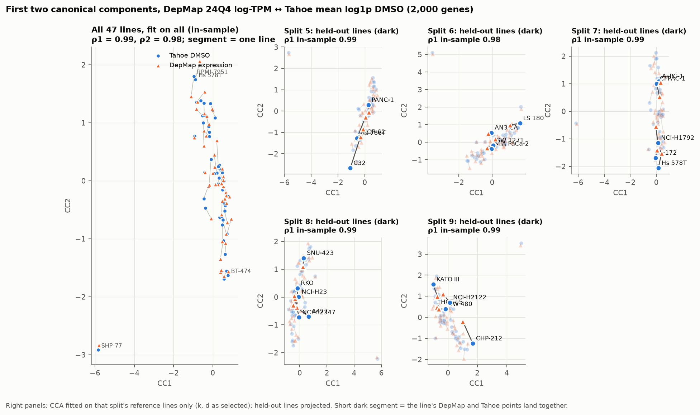
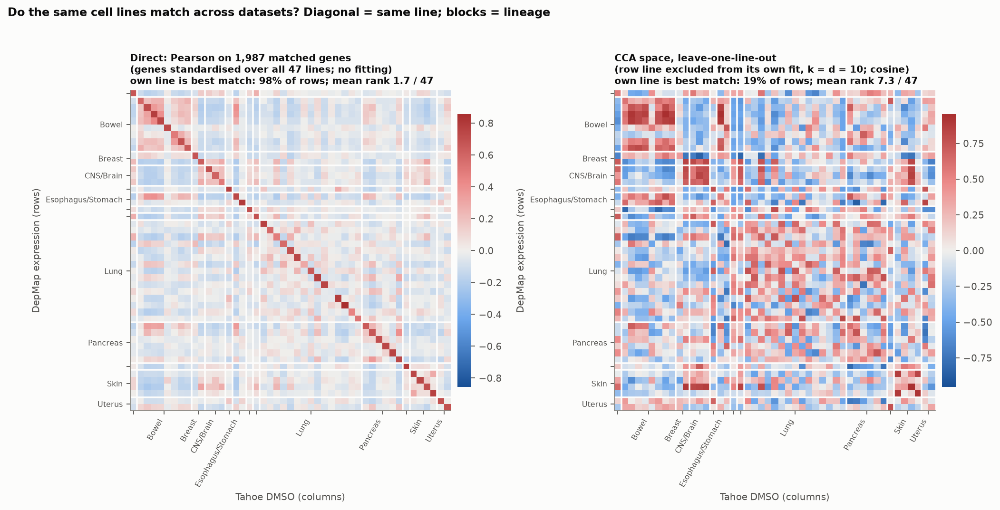
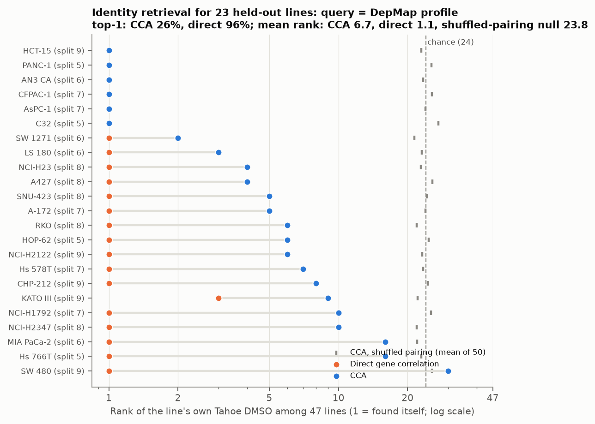
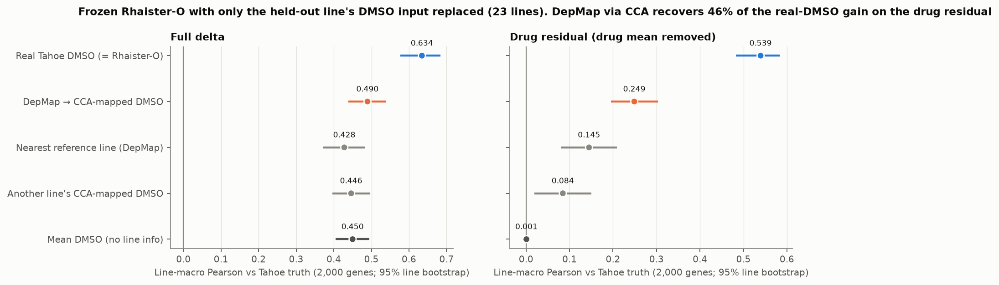
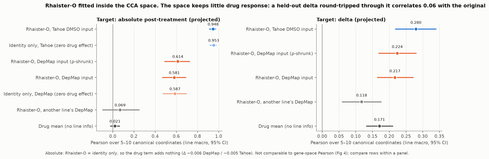

# Therapeutic — Weekly Report, week ending Friday 2026-10-09

Reporting interval: [2026-10-02T18:00:00+04:00, 2026-10-09T18:00:00+04:00) — Asia/Dubai.

Measured results only, with provenance; include positive and negative findings.

**Where to look (sections were appended as results arrived, so numbering is not monotone):**
L1000 unseen-drug benchmark and gates §1.1-1.5; plate-controlled numbers §1.7 and §4.4 (quote these);
applicability domain §1.6; Tahoe replication §1.8 and §4.1; PrimeKG audit §2 and §4.2; learned
models / GNN §4.3, §4.5, §4.7; model-free PPI information test §4.6 (STRING) and §6 (eight networks,
RECOMB E1/E7); DeepCE reproduction §5.1-5.4 (final ablation §5.3, node2vec ladder §5.4); integrated
MKL model §7. Interim snapshot §3 and interim §5.2 are superseded.

## 1. Unseen-drug prediction on LINCS L1000 (secondary task; pre-registered in `10_09_record.md`, 2026-10-03)

Whole compounds are held out; every cell line is seen. A compound is the InChIKey of the
RDKit-standardized parent; signatures of all its pert_ids in one line are averaged. ACTIVE =
mean TAS ≥ 0.2 (the primary cohort). Folds are grouped by InChIKey connectivity block (ik14) so
stereoisomers never straddle train and test. Metric: per-(compound, line) Pearson over the 978
landmarks of the full Level-5 signature ("full") and of the residual from the training mean
("resid"); line-macro means; 2,000-replicate bootstrap over ik14 groups resampled jointly
across lines.

### 1.1 Data slices (jobs 292886/292887 extraction, 292925/292926 build)

| slice | source | time, dose | lines | rows | compounds | ACTIVE rows |
|---|---|---|---|---|---|---|
| P1-24 (primary) | GSE92742 Level 5 | 24 h, 10 µM | PC3, MCF7, VCAP, A549, HA1E, A375, HCC515 | 31,229 | 8,119 | 12,279 |
| P1-6 | GSE92742 | 6 h, 10 µM | + HT29, HEPG2 (9 lines) | 47,115 | 7,626 | 16,092 |
| P2-24 | GSE70138 Level 5 | 24 h, 10 µM | HT29, MCF7, PC3, A375, HA1E, YAPC, HELA | 11,676 | 1,725 | 5,477 |

- 20,350 SMILES-bearing GSE92742 trt_cp pert_ids collapse to 9,174 ik14 blocks; the largest
  blocks are Broad DOS stereoisomer families (up to 32 members).
- Target annotation (LINCS2020 `compoundinfo_beta.txt`) maps into STRING v12 physical
  (score ≥ 400; 15,809 genes, 210,667 edges) for 2,176/8,119 (P1-24) and 1,170/1,725 (P2-24)
  compounds (KNOWN).
- LINCS Cell Painting (A549, 48 h; spherized DMSO-normalized consensus MODZ, 1,026 features):
  10 µM profiles for 748/8,119 (P1-24) and 1,550/1,725 (P2-24) compounds (MORPH).
- Frozen SMILES-LM embeddings: ChemBERTa-77M-MLM (384-d) and MoLFormer-XL-both-10pct (768-d),
  masked mean of the last layer, job 292898.

### 1.2 Does chemical similarity predict transcriptional similarity? (Q1, job 292932)

ACTIVE compounds only, pairs of different ik14, line means. Source:
`/nfs-stor/yuqi.lei/Therapeutic/results/l1000_structure_response/<slice>/{lines,pairs,bins,density}.csv`.

| quantity | P1-24 | P1-6 | P2-24 |
|---|---|---|---|
| base rate of response-similar pairs, P(r ≥ 0.5) | 0.018 | 0.012 | 0.018 |
| P(r ≥ 0.5 \| Morgan Tanimoto ≥ 0.85) | 0.381 | 0.270 | 0.470 |
| P(r ≥ 0.5 \| Tanimoto 0.6-0.85) | 0.198 | 0.142 | 0.300 |
| P(r ≥ 0.5 \| Tanimoto < 0.2) (≥ 95% of pairs) | 0.017 | 0.011 | 0.017 |
| P(r ≥ 0.5 \| share ≥ 1 target), KNOWN | 0.190 | 0.146 | 0.145 |
| P(r ≥ 0.5 \| no shared target), KNOWN | 0.020 | 0.014 | 0.017 |
| stereoisomer pairs (same ik14): P(r ≥ 0.5) / median r | 0.389 / 0.404 | 0.273 / 0.338 | 0.409 / 0.434 (73 pairs) |
| Spearman(similarity, r), Morgan / MoLFormer / RDKit-2D | 0.009 / 0.032 / 0.031 | 0.007 / 0.024 / 0.024 | 0.049 / 0.065 / 0.076 |
| AUROC of similarity for r ≥ 0.5, Morgan / MoLFormer / RDKit-2D | 0.546 / 0.576 / 0.576 | 0.544 / 0.572 / 0.572 | 0.590 / 0.605 / 0.611 |
| **share of active compounds with a response twin (r ≥ 0.5) in the line's library** | **0.728** | **0.720** | **0.646** |
| share whose Morgan nearest neighbour is such a twin | 0.114 | 0.110 | 0.124 |
| same, best encoder (MoLFormer / ChemBERTa / Morgan) | 0.111-0.114 | 0.104-0.110 | 0.111-0.124 |

- Very similar chemistry is strongly enriched for similar response (×20-25 over the base rate)
  but such pairs are rare (804 of 8.3 M pairs at Tanimoto ≥ 0.85 in P1-24). Across all pairs the
  rank correlation between chemical and response similarity is ≤ 0.08 for every encoder.
- Stereoisomers with identical 2D fingerprints respond alike only 27-41% of the time.
- **The library is dense in response space (65-73% of active compounds have a twin) but the
  chemical nearest neighbour is that twin only 10-12% of the time, for every encoder.**
- These pairwise statistics are not plate-controlled; see §1.5.

### 1.3 Gate contrasts, ik14 split (jobs 292927 P1-24, 292928 P1-6, 292929 P2-24)

Full-signature Pearson difference, line-macro, [bootstrap 95% interval], lines positive.
Source: `/nfs-stor/yuqi.lei/Therapeutic/results/l1000_unseen_drug/<slice>_ik14_seed0/contrasts.csv`.

| contrast (cohort) | P1-24 | P1-6 | P2-24 |
|---|---|---|---|
| G1 `knn_chem_select` − `mean` (ACTIVE) | +0.0506 [0.0458, 0.0560] 7/7 | +0.0541 [0.0488, 0.0597] 9/9 | +0.0347 [0.0298, 0.0396] 7/7 |
| `oracle_knn` − `mean` (ACTIVE; ceiling) | +0.4088 | +0.4206 | +0.3380 |
| `krr_morgan2` − `knn_morgan2` (ACTIVE) | +0.0017 [−0.0003, 0.0036] | +0.0006 [−0.0013, 0.0026] | −0.0020 [−0.0045, 0.0004] |
| G2 `knn_chemberta` − `knn_morgan2` | **−0.0034** [−0.0057, −0.0013] 0/7 | **−0.0041** [−0.0064, −0.0018] 0/9 | **−0.0035** [−0.0064, −0.0006] 1/7 |
| G2 `knn_molformer` − `knn_morgan2` | +0.0005 [−0.0017, 0.0025] | +0.0005 [−0.0015, 0.0026] | −0.0014 [−0.0040, 0.0012] |
| `knn_maccs` − `knn_morgan2` | −0.0066 [−0.0090, −0.0043] | −0.0054 [−0.0076, −0.0032] | −0.0044 [−0.0072, −0.0014] |
| `knn_rdkit2d` − `knn_morgan2` | +0.0007 [−0.0016, 0.0030] | +0.0008 [−0.0016, 0.0033] | −0.0017 [−0.0050, 0.0014] |
| `knn_morgan2` − `knn_morgan2_xplate` (plate confound) | **+0.0197** [0.0175, 0.0221] | **+0.0239** [0.0213, 0.0266] | +0.0050 [0.0034, 0.0068] |
| `oracle_knn` − `oracle_xplate_knn` | +0.0361 | +0.0338 | +0.0233 |
| `knn_chem_known` − `mean` (KNOWN_ACTIVE) | +0.0483 | +0.0451 | +0.0318 |
| G3 `knn_target` − `knn_chem_known` | +0.0044 [−0.0003, 0.0090] | +0.0072 [0.0021, 0.0125] | +0.0076 [0.0018, 0.0135] |
| G3 `knn_ppi` − `knn_chem_known` | +0.0134 [0.0080, 0.0189] 7/7 | +0.0174 [0.0124, 0.0230] 9/9 | +0.0128 [0.0069, 0.0187] 7/7 |
| G3 `knn_ppi` − `knn_ppi_rewired` | +0.0019 [0.0006, 0.0032] | +0.0034 [0.0023, 0.0045] | +0.0031 [0.0018, 0.0045] |
| G3 `knn_target` − `knn_target_perm` | +0.0424 [0.0347, 0.0512] | +0.0475 [0.0377, 0.0577] | +0.0390 [0.0324, 0.0458] |
| `knn_chem_target` − `knn_chem_known` | +0.0136 [0.0092, 0.0181] | +0.0190 [0.0145, 0.0240] | +0.0166 [0.0118, 0.0219] |
| `moa_knn` − `knn_chem_known` | +0.0147 [0.0091, 0.0208] | +0.0160 [0.0094, 0.0227] | +0.0165 [0.0103, 0.0228] |
| `krr_ppi` − `krr_ppi_rewired` | +0.0013 [0.0005, 0.0021] | +0.0012 [0.0008, 0.0016] | +0.0008 [0.0004, 0.0012] |
| `krr_chem_target` − `krr_chem_known` | +0.0155 [0.0119, 0.0190] | +0.0184 [0.0146, 0.0226] | +0.0186 [0.0149, 0.0225] |
| G4 `xcell1_knn` − `knn_chem_select` (XCELL_ACTIVE) | **+0.1047** [0.0986, 0.1108] 7/7 | **+0.0982** [0.0920, 0.1043] 9/9 | **+0.1491** [0.1406, 0.1577] 7/7 |
| `xcell_knn` − `knn_chem_select` (all other lines) | +0.1392 | +0.1575 | +0.1950 |
| `xcell1_copy` − `knn_chem_select` | −0.0078 [−0.0130, −0.0027] | −0.0040 [−0.0091, 0.0013] | +0.0283 [0.0224, 0.0341] |
| G5 `knn_morph` − `knn_chem_morphpool` (MORPH_ACTIVE) | +0.0282 [0.0177, 0.0386] 7/7 | +0.0266 [0.0150, 0.0393] 9/9 | +0.0948 [0.0867, 0.1031] 7/7 |
| `knn_chem_morph` − `knn_chem_morphpool` | +0.0445 | +0.0416 | +0.0971 |
| `xcell1_knn` − `knn_morph` (MORPH_XCELL_ACTIVE) | +0.0909 [0.0769, 0.1058] | +0.0993 [0.0835, 0.1160] | +0.0552 [0.0476, 0.0624] |

Absolute ACTIVE scores, P1-24 (full / resid / top-100 overlap): `mean` 0.280 / 0 / 0.186;
`knn_morgan2` 0.330 / 0.161 / 0.219; `knn_morgan2_xplate` 0.311 / 0.108 / 0.205;
`knn_molformer` 0.331 / 0.175; `knn_chemberta` 0.327 / 0.164; `oracle_knn` 0.689 / 0.657 / 0.412.
P2-24: `mean` 0.329; `knn_morgan2` 0.364 / 0.163; `oracle_knn` 0.667 / 0.611. Chemistry
retrieval captures **12% (P1-24) and 10% (P2-24) of the oracle headroom** on the full signature
(`headroom.csv`). Magnitude (Spearman of predicted vs true residual norm, ALL rows): chemistry
arms 0.10-0.17, `oracle_knn` 0.53-0.59; AUROC for ACTIVE from predicted norm 0.53-0.60 vs
0.79-0.88 for the oracle (`magnitude.csv`).

Scaffold split (jobs 292930 P1-24, 292931 P2-24): G1 `knn_chem_select` − `mean` +0.0390
[0.0312, 0.0480] and +0.0277 [0.0229, 0.0326]; ChemBERTa − Morgan −0.0063 and −0.0056 (both
intervals below 0); `xcell1_knn` − `knn_chem_select` +0.1130 and +0.1546; `knn_morph` −
`knn_chem_morphpool` +0.0351 and +0.0975. The ranking of arms is unchanged.

### 1.4 Gate verdicts as pre-registered

| gate | verdict |
|---|---|
| G1 chemistry retrieval beats the mean | pass (all slices, both splits); but see §1.5 |
| G2 SMILES language models beat fingerprints | **fail** (ChemBERTa significantly worse; MoLFormer tied) |
| G3 knowledge beyond chemistry | target/PPI similarity beats chemistry by +0.013-0.017; PPI topology over a degree-preserving rewired graph adds only +0.002-0.003 (interval > 0, below the +0.01 meaning threshold) |
| G4 one measured context | pass, +0.10 to +0.15, the largest effect |
| G5 Cell Painting morphology beats chemistry | pass in both slices; the P2-24 size is confounded (§1.5) |

### 1.5 Plate confound (X1, exploratory, post hoc; `scripts/analyze_l1000_plate_confound.py`)

Pairs of ACTIVE compounds (different ik14) by Morgan Tanimoto × whether they share an L1000
plate in that line. Source: `/nfs-stor/yuqi.lei/Therapeutic/results/l1000_plate_confound/<slice>/`.

| Tanimoto | P1-24 same plate: P(r ≥ 0.5) / median r | P1-24 different plate | P2-24 same plate | P2-24 different plate |
|---|---|---|---|---|
| < 0.2 | 0.046 / 0.104 | 0.014 / 0.078 | 0.059 / 0.153 | 0.015 / 0.100 |
| 0.2-0.4 | 0.073 / 0.109 | 0.030 / 0.083 | 0.117 / 0.196 | 0.045 / 0.135 |
| 0.4-0.6 | 0.155 / 0.190 | 0.112 / 0.169 | 0.359 / 0.400 | 0.209 / 0.273 |
| ≥ 0.6 | 0.262 / 0.286 | 0.186 / 0.222 | 0.382 / 0.374 | 0.309 / 0.364 |

- **At equal (and negligible) chemical similarity, same-plate pairs are 3-4× more often
  response-similar.** Level-5 signatures retain a plate component that a new compound measured
  on its own plate cannot share.
- Chemistry still carries signal across plates: different-plate pairs at Tanimoto ≥ 0.6 are
  response-similar 19-31% of the time against a 1.4-1.5% base rate.
- Morphology, P2-24: among the top-1% most morphologically similar pairs, P(r ≥ 0.5) is 0.253
  for same-L1000-plate pairs and 0.016 for different-plate pairs (base 0.012-0.015). 92.5% of
  same-L1000-plate pairs also share a Cell Painting plate map, against 0.01% of different-plate
  pairs: Phase-II L1000 and the Cell Painting batch were run from the same Drug Repurposing Hub
  plate layouts. In P1-24 the two are unrelated (3.8% vs 3.6%) and the morphology excess is
  smaller (top 1%: 0.082 same-plate vs 0.035 different-plate).
- Consequence: the P2-24 morphology gain (+0.095) and part of every retrieval gain are plate
  co-membership. The plate-controlled re-runs (X2 neighbour exclusion; plate-map grouped split
  for all models) are in progress and will replace these numbers for interpretation.

## 2. Drug-target and PPI knowledge-base overlap (PrimeKG v2.1 vs current annotation)

Source: `scripts/audit_primekg_overlap.py`; outputs `/nfs-stor/yuqi.lei/Therapeutic/results/primekg_overlap/`.
PrimeKG v2.1 (Harvard Dataverse doi:10.7910/DVN/IXA7BM; record licence CC0 1.0; `kg.csv`
981,751,236 bytes). DrugBank IDs mapped to InChIKey via PubChem PUG-REST (cache
`derived/l1000_unseen_drug/primekg_drugbank_pubchem_inchikey.tsv`): 5,500 of the 6,282 drugs that
have protein edges. PrimeKG drug-protein edges: target 16,380, enzyme 5,317, transporter 3,092,
carrier 864. Matching by full InChIKey, then connectivity block.

| compound set | compounds | in PrimeKG (any protein edge) | with current targets (LINCS2020 / Tahoe) | with PrimeKG targets | with either | gained only from PrimeKG | median Jaccard where both |
|---|---|---|---|---|---|---|---|
| L1000 P1-24 | 8,119 | 1,567 | 2,205 | 1,418 | 2,537 | 332 (+15%) | 0.50 |
| L1000 P1-6 | 7,626 | 1,572 | 2,205 | 1,423 | 2,541 | 336 | 0.50 |
| L1000 P2-24 | 1,725 | 990 | 1,182 | 894 | 1,353 | 171 (+14%) | 0.50 |
| Tahoe (with SMILES) | 352 | 238 | 247 | 216 | 300 | 53 (+21%) | 0.50 |

- 97% of PrimeKG target genes are present in STRING v12 physical (score ≥ 400).
- About 69% of P1-24 compounds (largely Broad DOS) have target knowledge in neither source.

| PPI resource | edges (undirected) | genes | L1000 landmarks covered (of 978) |
|---|---|---|---|
| STRING v12 physical, score ≥ 400 | 210,667 | 15,809 | 917 |
| PrimeKG protein_protein | 321,075 | 18,354 | 948 |
| shared edges | 60,645 (29% of STRING, 19% of PrimeKG) | | |

### 1.6 Applicability domain: chemistry gain vs nearest training analogue (X4, exploratory)

ACTIVE rows of the official ik14 runs; gain = full-signature Pearson minus `mean`. Source:
`/nfs-stor/yuqi.lei/Therapeutic/results/l1000_applicability/<slice>_ik14.csv`.

| max Morgan Tanimoto to training | P2-24 share of rows | P2-24 `knn_morgan2` gain | P2-24 same-plate excluded | P1-24 share | P1-24 gain | P1-24 same-plate excluded | oracle gain (P2 / P1) |
|---|---|---|---|---|---|---|---|
| < 0.3 | 0.294 | +0.0063 | +0.0024 | 0.111 | +0.0003 | −0.0023 | 0.335 / 0.411 |
| 0.3-0.4 | 0.243 | +0.0211 | +0.0169 | 0.149 | +0.0081 | +0.0044 | 0.330 / 0.408 |
| 0.4-0.5 | 0.177 | +0.0498 | +0.0438 | 0.118 | +0.0255 | +0.0114 | 0.353 / 0.413 |
| 0.5-0.6 | 0.107 | +0.0411 | +0.0345 | 0.120 | +0.0537 | +0.0343 | 0.328 / 0.427 |
| 0.6-0.8 | 0.151 | +0.0636 | +0.0572 | 0.308 | +0.0775 | +0.0477 | 0.345 / 0.414 |
| ≥ 0.8 | 0.029 | +0.1770 | +0.1684 | 0.194 | +0.0820 | +0.0569 | 0.339 / 0.423 |

Chemistry retrieval helps only when a close analogue exists; the oracle headroom does not
depend on the chemical neighbourhood. In P2-24 (mostly annotated drugs) 82% of active test rows
have no training analogue at Tanimoto ≥ 0.6; in P1-24 the DOS libraries make the library
chemically denser (50% of rows ≥ 0.6).

### 1.7 Plate-controlled re-estimates (X2 same-plate neighbour exclusion, job 294074; X3 plate-map split, job 294088)

Full-signature Pearson, ACTIVE-type cohorts, line-macro [bootstrap 95%] lines positive. Source:
`results/l1000_unseen_drug/_summary_pearson_full.csv` (`scripts/summarize_l1000_unseen_runs.py`).
X3 bootstrap resamples plate maps. KRR under X2 masking is not a valid estimator (§ record) and is
omitted from the X2 column.

| P2-24 contrast | ik14 (official) | X2 same-plate excluded | X3 plate-map split |
|---|---|---|---|
| best chemistry kNN − mean | +0.0347 [0.0298, 0.0396] | +0.0292 [0.0247, 0.0339] | +0.0280 [0.0234, 0.0325] 7/7 |
| oracle kNN − mean | +0.3380 | +0.3147 | +0.3222 |
| ChemBERTa − Morgan | −0.0035* | −0.0049* | −0.0062* |
| MoLFormer − Morgan | −0.0014 | −0.0018 | −0.0026 |
| Morgan KRR − mean | +0.0328 | (invalid) | +0.0274 [0.0236, 0.0310] |
| PPI kNN − chemistry kNN (KNOWN) | +0.0128* | +0.0105* | +0.0065 [0.0018, 0.0116] |
| PPI − rewired PPI (kNN) | +0.0031* | +0.0011* | +0.0015 [0.0004, 0.0026] |
| target-Jaccard − chemistry (KNOWN) | +0.0076* | +0.0070* | +0.0013 [−0.0034, 0.0064] |
| chemistry + targets − chemistry (kNN) | +0.0166* | +0.0157* | +0.0105 [0.0066, 0.0149] |
| chemistry + targets − chemistry (KRR) | +0.0186* | (invalid) | +0.0150 [0.0118, 0.0182] |
| one other line (xcell1) − best chemistry | +0.1491* | +0.1241* | +0.1298 [0.1177, 0.1421] |
| all other lines (xcell) − best chemistry | +0.1950* | +0.1655* | +0.1729 [0.1600, 0.1855] |
| Cell Painting − chemistry (MORPH pool) | +0.0948* | +0.0544* | +0.0549 [0.0459, 0.0643] |

`*` interval excludes 0. Under both plate controls the ordering is unchanged; morphology loses
~42% of its ik14 advantage (shared plate layouts, §1.5) but remains +0.054, about twice the
chemistry gain over the mean.

### 1.8 Tahoe replication (jobs 294113 T-5, 294114 T-0.5, ik14; 294115 T-5 platemap)

350 compounds × 50 lines per dose, 2,000-gene deltas, ACTIVE = delta norm ≥ line median.
Source: `results/l1000_unseen_drug/T-*_seed0/`.

| contrast (ACTIVE unless noted) | T-5 (5 µM) | T-0.5 (0.5 µM) |
|---|---|---|
| `mean` full Pearson (absolute) | 0.398 | 0.644 |
| best chemistry kNN − mean | +0.0169 [0.0009, 0.0329] 46/50 | +0.0205 [0.0119, 0.0299] 50/50 |
| Morgan kNN − mean | +0.0243 | +0.0206 |
| **Morgan kNN with same-plate neighbours excluded − mean** | **−0.0010** [−0.0069, 0.0057] 22/50 | **−0.0006** [−0.0040, 0.0032] 24/50 |
| oracle − mean / oracle with same-plate excluded − mean | +0.447 / +0.312 | +0.225 / +0.119 |
| ChemBERTa − Morgan | −0.0111 [−0.0230, −0.0002] | −0.0016 (ns) |
| PPI kNN − chemistry kNN (KNOWN, 245 compounds) | +0.0204 [0.0039, 0.0376] | −0.0011 (ns) |
| PPI − rewired PPI | +0.0044 [0.0006, 0.0083] | +0.0042 [0.0007, 0.0076] |
| chemistry + targets − chemistry (KRR) | +0.0266 [0.0133, 0.0402] | +0.0006 (ns) |
| one other line (xcell1) − best chemistry | **+0.3435** [0.3145, 0.3733] 50/50 | **+0.1515** [0.1339, 0.1737] 50/50 |
| Cell Painting − chemistry (99 compounds) | −0.0010 (ns) | −0.0004 (ns) |

- **On Tahoe the whole chemistry-retrieval gain is same-plate co-membership** (drugs on one
  Tahoe plate share its DMSO control): excluding same-plate neighbours takes Morgan kNN to the
  mean at both doses. The oracle loses 0.11-0.13 to the same exclusion.
- The T-5 plate-map split (294115) is degenerate: 5 µM conditions sit on few plates, only 2 of 5
  folds receive test compounds, training shares are 27% and 44%, and inner selection picks k = 1,
  α = 2. Its chemistry − mean of −0.107 is not interpretable; Tahoe plate-controlled knowledge
  arms are being re-estimated with same-plate exclusion (jobs 294181, 294182).

## 3. Interim wrap-up, 2026-10-03 22:15 (pre-meeting snapshot)

Robust across L1000 P1-24 / P1-6 / P2-24, both splits and the plate controls, and replicated in
direction on Tahoe:

| finding | strongest plate-controlled number |
|---|---|
| chemistry retrieval beats the training mean, but captures only ~10% of the oracle headroom | P2-24 plate-map split +0.028 [0.023, 0.033] vs oracle +0.322 |
| chemistry helps only with a close analogue (Tanimoto ≥ 0.6) | gain ~0 below 0.3; +0.06 to +0.18 above 0.6 (§1.6) |
| learned SMILES encoders do not beat Morgan | ChemBERTa − Morgan −0.006 [−0.010, −0.003] (plate-map) |
| target knowledge adds a little; PPI topology adds almost nothing | chemistry+targets − chemistry +0.011 to +0.015; PPI − rewired +0.0015 [0.0004, 0.0026] |
| one measurement of the new drug in another line dominates | +0.130 [0.118, 0.142] over best chemistry (plate-map) |
| Cell Painting morphology beats chemistry after plate control | +0.055 [0.046, 0.064] (plate-map); ik14 +0.095 was ~42% shared plate layout |
| plate co-membership inflates retrieval in L1000 and fully explains it on Tahoe | Tahoe Morgan kNN − mean +0.024 → −0.001 with same-plate neighbours excluded |

Still running at the snapshot (results will be appended): trained GNN vs rewired / no-graph /
MLP controls (294193 P2-24 ik14, 294194 P2-24 platemap, 294195 P1-24 ik14); P1-24/P1-6 same-plate
exclusion (294075, 294076) and plate-map split (294091, 294092); Tahoe same-plate exclusion
(294181, 294182); PrimeKG target union (294120).

## 4. Results added 2026-10-04 (after the meeting snapshot)

### 4.1 Same-plate exclusion on P1 and Tahoe (X2; jobs 294075 P1-24, 294076 P1-6, 294181 T-5, 294182 T-0.5)

Full-signature Pearson, line-macro [95% bootstrap] lines positive. KRR rows omitted (the X2 mask
makes KRR invalid; see record). Source: `results/l1000_unseen_drug/_summary_pearson_full.csv`.

| contrast | P1-24 | P1-6 | Tahoe T-0.5 | Tahoe T-5 |
|---|---|---|---|---|
| best chemistry kNN − mean (ACTIVE) | +0.0299 [0.0257, 0.0343] 7/7 | +0.0301 [0.0259, 0.0345] 9/9 | −0.0008 [−0.0043, 0.0028] 21/50 | −0.0017 [−0.0077, 0.0050] 15/50 |
| (same, ik14 without exclusion) | +0.0506 | +0.0541 | +0.0205 | +0.0169 |
| oracle − mean | +0.3727 | +0.3868 | +0.1189 | +0.3118 |
| ChemBERTa − Morgan | −0.0037* | −0.0052* | −0.0013 | +0.0018 |
| MoLFormer − Morgan | −0.0017* | −0.0019* | −0.0008 | +0.0014 |
| PPI kNN − chemistry kNN (KNOWN) | +0.0103* | +0.0140* | +0.0025 | +0.0030 |
| PPI − rewired PPI | +0.0027* | +0.0029* | +0.0004 | +0.0001 |
| target-Jaccard − chemistry | +0.0034 | +0.0087* | +0.0019 | +0.0043 |
| chemistry + targets − chemistry (kNN) | +0.0096* | +0.0146* | +0.0020* | +0.0033 |
| one other line (xcell1) − best chemistry | +0.0749* | +0.0766* | +0.0501* 49/50 | +0.1788* 50/50 |
| Cell Painting − chemistry (MORPH) | +0.0300* | +0.0253* | −0.0003 | −0.0014 |

`*` interval excludes 0. Same-plate neighbours account for 41% (P1-24) and 44% (P1-6) of the
chemistry gain and for all of it on Tahoe. Morphology's P1 advantage is unchanged by the exclusion
(P1 Cell Painting plate maps are unrelated to P1 L1000 plates). After plate control on Tahoe, no
prior-knowledge arm adds more than +0.004; only the measured response elsewhere helps.

### 4.2 PrimeKG/DrugBank target union (X5; job 294120, P2-24 ik14)

KNOWN grows from 1,170 to 1,342 compounds. Paired on the 3,683 originally-KNOWN active rows
(union − LINCS2020 targets only): `knn_target` −0.0013 [−0.0038, 0.0013], `knn_ppi` −0.0016
[−0.0041, 0.0010], `knn_chem_target` +0.0010 [−0.0011, 0.0032], `krr_chem_target` +0.0006
[−0.0010, 0.0023], `moa_knn` +0.0003. On the 575 active rows of newly annotated compounds,
`knn_chem_target` − `knn_chem_known` = +0.011 (similar to the originally annotated set).
PrimeKG adds coverage, not better targets for compounds already annotated.

### 4.3 Trained GNN: G3b inconclusive under the pre-specified training (jobs 294193, 294194)

The GNN script's `mean` arm equals the kNN runner's bit for bit (max |Δ| 0.0). Every neural arm
selected its first-epoch weights in every fold (early stop at epoch 16), so all are effectively
the mean:

| P2-24, KNOWN∩ACTIVE, full / resid Pearson | ik14 | platemap |
|---|---|---|
| mean | 0.3317 / 0 | 0.3157 / 0 |
| gnn_ppi · gnn_rewired · gnn_nograph | 0.3317 · 0.3317 · 0.3317 | 0.3154 · 0.3155 · 0.3155 |
| mlp_target · mlp_chem · mlp_chem_all | 0.3319 · 0.3340 · 0.3331 | 0.3143 · 0.3145 · 0.3158 |
| (kNN) chemistry · PPI | 0.3635 · 0.3763 | 0.3431 · 0.3497 |
| (KRR) chemistry · PPI | 0.3616 · 0.3791 | 0.3403 · 0.3524 |

Exploratory re-runs with inner-validation output shrinkage (as every kNN/KRR arm has) are queued:
294352 (ik14), 294353 (ik14, lr 3e-4), 294354 (platemap).

### 4.4 Plate-map grouped split on all three L1000 slices (X3; jobs 294091 P1-24, 294092 P1-6, 294088 P2-24)

No training compound shares an L1000 plate map with a test compound (in any line); inner CV uses
the same rule; the bootstrap resamples plate maps. Test-eligible: 6,045/8,119 (P1-24),
5,761/7,626 (P1-6), 1,635/1,725 (P2-24). **This is the table to quote.**

| contrast (full Pearson) | P1-24 | P1-6 | P2-24 |
|---|---|---|---|
| best chemistry kNN − mean (ACTIVE) | +0.0234 [0.0178, 0.0289] 7/7 | +0.0286 [0.0208, 0.0365] 9/9 | +0.0280 [0.0234, 0.0325] 7/7 |
| Morgan KRR − mean | +0.0208 | +0.0258 | +0.0274 |
| oracle − mean (ceiling) | +0.3777 | +0.3943 | +0.3222 |
| ChemBERTa − Morgan | −0.0063 [−0.0105, −0.0020] | −0.0066 [−0.0102, −0.0035] | −0.0062 [−0.0096, −0.0031] |
| MoLFormer − Morgan | −0.0032 [−0.0073, 0.0007] | −0.0039 [−0.0058, −0.0021] | −0.0026 [−0.0056, 0.0002] |
| PPI kNN − chemistry kNN (KNOWN) | +0.0130 [0.0072, 0.0212] | +0.0130 [0.0045, 0.0211] | +0.0065 [0.0018, 0.0116] |
| PPI − rewired PPI (kNN) | +0.0016 [−0.0008, 0.0031] | +0.0016 [0.0001, 0.0034] | +0.0015 [0.0004, 0.0026] |
| PPI − rewired PPI (KRR) | +0.0003 [−0.0002, 0.0010] | +0.0004 [−0.0002, 0.0009] | +0.0006 [0.0001, 0.0011] |
| chemistry + targets − chemistry (KRR) | +0.0172 [0.0093, 0.0214] | +0.0184 [0.0138, 0.0239] | +0.0150 [0.0118, 0.0182] |
| one other line (xcell1) − best chemistry | +0.0765 [0.0654, 0.0898] | +0.0763 [0.0643, 0.0911] | +0.1298 [0.1177, 0.1421] |
| all other lines − best chemistry | +0.1006 | +0.1215 | +0.1729 |
| Cell Painting − chemistry (MORPH) | +0.0330 [0.0157, 0.0585] | +0.0182 [0.0051, 0.0313] | +0.0549 [0.0459, 0.0643] |

Chemistry captures 6-9% of the oracle headroom under plate control.

### 4.5 Learned models: GNN, MLPs and MLP + PPI features (P2-24; jobs 294352, 294353, 294354, 294396)

All with inner-validation output shrinkage (`--shrink`, exploratory); paired with the kNN/KRR
runner on KNOWN∩ACTIVE rows (`scripts/compare_l1000_gnn.py`; the `mean` arm agrees to 0.0).
Full Pearson difference [95% bootstrap] lines positive.

| contrast | ik14, lr 1e-3 | ik14, lr 3e-4 | platemap |
|---|---|---|---|
| `gnn_ppi` − mean | +0.0010 [0.0005, 0.0016] | +0.0003 | +0.0002 (ns) |
| `gnn_ppi` − `gnn_rewired` | −0.0001 (ns) | −0.0001 (ns) | −0.0001 (ns) |
| `mlp_target` − mean | +0.0296 [0.0223, 0.0373] | +0.0193 | +0.0282 [0.0235, 0.0326] |
| `mlp_target` − `mlp_chem` (targets in an MLP) | +0.0047 [0.0009, 0.0088] | −0.0031 (ns) | +0.0098 [0.0069, 0.0126] |
| `mlp_chem` − `knn_chem_known` | −0.0069 [−0.0107, −0.0032] | −0.0095 | −0.0092 |
| `mlp_target` − `krr_chem_target` | −0.0190 [−0.0240, −0.0142] | −0.0294 | −0.0115 |
| `mlp_chem_all` − `knn_chem_select` (ACTIVE) | −0.0087 [−0.0122, −0.0052] | −0.0106 | −0.0073 |

MLP + PPI features (job 294396, ik14, lr 1e-3): `mlp_ppi` = `mlp_target` plus the drug's target
signal propagated 0-3 hops over STRING, read at all 978 landmarks.

| contrast | value |
|---|---|
| `mlp_ppi` − mean | +0.0419 [0.0342, 0.0497] 7/7 |
| `mlp_ppi` − `mlp_target` (graph features vs none) | +0.0123 [0.0078, 0.0172] 7/7 |
| `mlp_ppi` − `mlp_ppi_nograph` (propagation vs hop 0 only) | +0.0092 [0.0047, 0.0138] 7/7 |
| **`mlp_ppi` − `mlp_ppi_rewired` (real vs degree-preserving random graph)** | **−0.0013 [−0.0037, 0.0012] 3/7** |
| `mlp_ppi` − `krr_ppi` | −0.0054 [−0.0095, −0.0012] |

- The decoupled GNN does not learn under any setting tried (gene-specific output only through a
  small shared head). This is an architecture/optimization failure and says nothing about the
  graph.
- Inside an MLP that does learn, propagating targets over a graph helps (+0.009 to +0.012), but a
  degree-preserving random graph helps exactly as much: the useful content is node degree, not
  the STRING wiring. Same conclusion as the kNN and KRR controls.
- Every learned model is below the corresponding kernel method on the same inputs (−0.005 to
  −0.029): at ~700-1,000 training compounds, kernels beat neural networks, as at 45 reference
  lines in the Rhaister-O work.

### 4.6 Does STRING wiring carry response information beyond degree? (model-free, job 294863; exploratory)

`scripts/analyze_ppi_information.py`; source `/nfs-stor/yuqi.lei/Therapeutic/results/ppi_information/{P2-24,P1-24}.csv`.
KNOWN compounds; residuals from the line mean over all compounds; line-macro means; "real − rew"
= real graph minus its seed-0 degree-preserving rewiring, with lines positive.
A = within-gene standardized |residual| at 1 hop from the drug's nearest target minus at ≥ 3 hops
(ACTIVE rows); A_rel = the same after dividing each signature by its own mean |residual|.
B = residual-signature Pearson of drug pairs on different L1000 plates by target-set distance.
C = Spearman(mean log(1 + target degree), residual norm), all KNOWN rows.

| quantity | P2-24 physical ≥400 | P2-24 functional ≥700 | P1-24 physical ≥400 | P1-24 functional ≥700 |
|---|---|---|---|---|
| A real / rewired | 0.181 / 0.213 | 0.190 / 0.188 | 0.159 / 0.169 | 0.176 / 0.168 |
| A, targets permuted among compounds | −0.004 | 0.003 | 0.003 | −0.001 |
| A_rel real − rew | −0.0067 (2/7) | +0.0119 (7/7) | +0.0255 (6/7) | +0.0254 (7/7) |
| A_rel real vs permutation 95th pct: lines above | 0/7 | 4/7 | 6/7 | 7/7 |
| share of landmark entries at 1 hop | 2.1% | 2.7% | 1.9% | 2.5% |
| B r, shared target (d = 0) | 0.132 | 0.132 | 0.177 | 0.177 |
| B r, targets 1 hop apart: real / rewired | 0.038 / 0.026 (+0.012, 7/7) | 0.036 / 0.022 (+0.014, 7/7) | 0.037 / 0.026 (+0.011, 7/7) | 0.037 / 0.034 (+0.004, 4/7) |
| B r, 2 hops: real − rew | +0.0003 (5/7) | +0.0005 (5/7) | +0.0010 (6/7) | −0.0003 (2/7) |
| B r, ≥ 3 hops | 0.004 | 0.003 | 0.009 | 0.009 |
| C ρ(target degree, response norm) | 0.216 (7/7) | 0.188 (7/7) | 0.167 (7/7) | 0.170 (7/7) |
| C ρ(number of targets, response norm) | 0.013 | 0.014 | −0.050 | −0.050 |

- The raw locality effect (A ≈ 0.16-0.21 SD) is the same on the rewired graph and vanishes when
  target sets are permuted: it is target degree, through response magnitude (C, ρ ≈ 0.2 in 28/28
  line-graph cells). Drugs with hub targets are near many genes and respond more strongly.
- With drug magnitude removed (A_rel), a small locality beyond degree appears in 3 of 4
  slice-graph combinations (+0.012 to +0.026), largest on the functional network; not on P2-24
  physical. It concerns the ~2-3% of landmark entries that sit 1 hop from a target.
- Drug pairs whose targets are direct neighbours respond more alike than on the rewired graph
  (+0.011 to +0.014 r, 7/7 lines, in three of four combinations), about a tenth of the
  shared-target excess. Two hops apart is indistinguishable from random.
- Wiring information exists, is confined to one hop, and is small relative to target identity and
  to degree; multi-hop propagation (RWR restart 0.5, hops 0-3) mixes it with degree-driven mass.

### 4.7 Dot-product head for the GNN (jobs 296290 ik14, 296291 plate-map; P2-24; exploratory)

`DotGNN` (`scripts/run_l1000_gnn.py`): the DecoupledGNN encoder unchanged, head replaced by
d' W_line g + a per-gene coefficient on the 0-3-hop propagated target signal; `--shrink`, lr 1e-3;
MLP arms re-run in the same job (identical to §4.5 to four decimals in every fold). Paired with
the kNN/KRR runner on KNOWN∩ACTIVE rows (`scripts/compare_l1000_gnn.py --tag _shrink_dot`); full
Pearson difference [95% bootstrap] lines positive. Source:
`/nfs-stor/yuqi.lei/Therapeutic/results/l1000_gnn/P2-24_{ik14,platemap}_seed0_shrink_dot/`.

| contrast | ik14 | plate-map |
|---|---|---|
| `dot_nograph` − mean | +0.0218 [0.0170, 0.0269] 7/7 | +0.0144 [0.0084, 0.0209] 7/7 |
| `dot_ppi` − mean (old concat head `gnn_ppi`: +0.0010 / +0.0002) | +0.0068 [0.0044, 0.0092] 7/7 | +0.0029 [0.0007, 0.0057] 7/7 |
| `dot_ppi` − `dot_nograph` | −0.0150 [−0.0191, −0.0110] 0/7 | −0.0115 [−0.0175, −0.0061] 0/7 |
| `dot_ppi` − `dot_rewired` | +0.0018 [0.0009, 0.0028] 7/7 | +0.0005 [0.0001, 0.0009] 7/7 |
| `dot_nograph` − `mlp_target` | −0.0078 [−0.0136, −0.0023] 0/7 | −0.0137 [−0.0198, −0.0074] 0/7 |
| `dot_ppi` − `mlp_ppi` | −0.0351 | −0.0341 |
| `dot_ppi` − `krr_ppi` | −0.0405 | −0.0338 |
| (re-run) `mlp_ppi` − `mlp_ppi_rewired` | −0.0013 [−0.0037, 0.0012] 3/7 | +0.0017 [−0.0005, 0.0038] 6/7 |

- The dot-product head makes the model learn (no-graph version +0.014 to +0.022 over the mean,
  against ≈ 0 for the concatenation head), but training is unstable: graph arms stopped at
  epoch 16-19 (best within the first 1-4 epochs) in 3/5 ik14 folds and 4/5 plate-map folds, and
  the no-graph arm in 2/5 plate-map folds; in those folds the inner-validation shrinkage picked
  α = 0, i.e. the mean. Arms that did train ran to the 150-epoch cap.
- Graph propagation in the encoder costs 0.012-0.015 against no graph; real vs rewired stays
  at +0.0005-0.0018. Every DotGNN arm remains below the flat MLP and below KRR.

## 5. DeepCE reproduction (repro/deepce; upstream pth1993/DeepCE @ 9b0d04f)

### 5.1 Baselines on DeepCE's own split (`repro/deepce/baselines.py`)

Upstream filter: 24 h, 7 lines (A375, HA1E, HELA, HT29, MCF7, PC3, YAPC), 6 doses; pert_id-disjoint
split; 1,895 / 544 / 496 train / dev / test conditions. Metric: upstream's mean per-signature Pearson
over 978 landmarks. Source: `/nfs-stor/yuqi.lei/Therapeutic/repro/deepce/results/baselines/summary.json`.

| method | test Pearson | RMSE | P@100 pos / neg |
|---|---|---|---|
| training mean (global) | 0.3134 | 1.901 | 0.164 / 0.217 |
| training mean per line | 0.3919 | 1.836 | 0.188 / 0.251 |
| training mean per (line, dose) | 0.3886 | 1.840 | 0.194 / 0.253 |
| Morgan kNN, k/τ/α chosen on dev (k = 100, τ = 0.03, α = 0.5) | **0.4511** | 1.755 | 0.250 / 0.294 |
| *paper, Table 1:* vanilla NN (PubChem) / kNN (PubChem) | 0.3929 / 0.3903 | 1.841 / 1.846 | |
| *paper:* DeepCE without attention / full DeepCE | 0.4418 / 0.4907 | 1.774 / 1.689 | 0.244 / 0.283 · 0.289 / 0.320 |

The paper's NN and kNN baselines are at the level of a per-line training mean; a tuned Morgan kNN
reaches 0.451, above DeepCE without attention. DeepCE's own runs are pending (§5.2).

### 5.2 Gene-feature ablation, INTERIM (2026-10-04 19:15; jobs 294915/294916 at epoch 54/53 of 60, 294917 complete)

`repro/deepce/analyze.py`; sources `/nfs-stor/yuqi.lei/Therapeutic/repro/deepce/results/ablation_{runs,contrasts}.csv`.
Test Pearson at the best-dev epoch (upstream metric), three seeds; paired contrasts average the
three seeds per test signature, bootstrap over the 92 test drugs. Superseded by §5.3 when the runs end.

| gene features | seed 0 / 1 / 2 | mean (sd) | optimistic best-test epoch, mean |
|---|---|---|---|
| `ppi` (upstream STRING vectors) | 0.464 / 0.456 / 0.428 | 0.449 (0.019) | 0.466 |
| `shuffled` (same vectors, permuted across genes) | 0.469 / 0.403 / 0.453 | 0.441 (0.035) | 0.445 |
| `random` (matched Gaussian) | 0.452 / 0.471 / 0.455 | 0.459 (0.011) | 0.468 |
| `onehot` (no prior, free gene embedding) | 0.463 / 0.476 / 0.459 | 0.466 (0.009) | 0.478 |
| *paper, Table 1* | | 0.4907 | |

| contrast (seed-averaged) | diff [95% drug bootstrap] |
|---|---|
| ppi − shuffled | +0.008 [−0.003, +0.019] |
| ppi − random | −0.010 [−0.023, +0.002] |
| ppi − onehot | **−0.017 [−0.027, −0.008]** |
| onehot − random | +0.007 [−0.004, +0.017] |
| ppi − Morgan kNN (§5.1) | −0.002 [−0.055, +0.048] |
| onehot − Morgan kNN | +0.015 [−0.038, +0.065] |
| ppi − per-line mean | +0.058 [+0.007, +0.105] |

- The STRING gene vectors add nothing: random and identity gene codes do at least as well, and
  the identity code is significantly better than the PPI vectors.
- Under best-dev model selection the paper's 0.4907 is not reached (0.428-0.464 for `ppi`); the
  optimistic best-test epoch gives 0.445-0.483. Best-dev epochs are late (33-59 of 60), so 60
  epochs may be short; the paper's epoch count is in an unavailable supplementary table.
- Every DeepCE variant is statistically indistinguishable from the tuned Morgan kNN on this split.
- Dev Pearson (0.39-0.42) is consistently below test Pearson (0.43-0.48): the 92 dev and 92 test
  drugs differ in difficulty, so dev-based selection is noisy.

### 5.3 Gene-feature ablation, FINAL (2026-10-04 20:38; jobs 294915-294917, all 60 epochs)

Supersedes §5.2. Same sources and method (`repro/deepce/analyze.py`; `results/ablation_{runs,contrasts}.csv`,
`ablation_absolute.json`).

| gene features | test Pearson at best-dev epoch, seed 0 / 1 / 2 | mean (sd) | optimistic best-test epoch, mean |
|---|---|---|---|
| `ppi` (upstream STRING vectors) | 0.481 / 0.456 / 0.428 | 0.455 (0.026) | 0.466 |
| `shuffled` (same vectors, permuted across genes) | 0.473 / 0.403 / 0.453 | 0.443 (0.036) | 0.447 |
| `random` (matched Gaussian) | 0.449 / 0.471 / 0.455 | 0.458 (0.011) | 0.469 |
| `onehot` (no prior, free gene embedding) | 0.463 / 0.476 / 0.459 | **0.466** (0.009) | 0.481 |
| Morgan kNN (§5.1) / per-line mean (§5.1) | | 0.451 / 0.392 | |
| *paper, Table 1, DeepCE* | | 0.4907 | |

| contrast (seed-averaged per signature) | diff [95% bootstrap over 92 test drugs] |
|---|---|
| ppi − shuffled | +0.012 [+0.001, +0.023] |
| ppi − random | −0.004 [−0.019, +0.013] |
| ppi − onehot | **−0.011 [−0.021, −0.003]** |
| onehot − random | +0.008 [−0.005, +0.021] |
| ppi − Morgan kNN | +0.004 [−0.050, +0.055] |
| onehot − Morgan kNN | +0.015 [−0.038, +0.065] |
| ppi − per-line mean | +0.063 [+0.012, +0.112] |

- The STRING gene vectors do not beat matched random vectors and are significantly below a plain
  one-hot gene identity. They beat the same vectors assigned to the wrong genes, which is the
  only contrast in their favour; since random ≈ ppi, this reads as misassigned structure hurting
  rather than correct structure helping.
- DeepCE's reported 0.4907 is not reached with best-dev selection (`ppi` 0.428-0.481); the
  best seed with optimistic best-test selection gives 0.4825. All variants are within the
  uncertainty of a tuned Morgan kNN.
- Seed spread (sd 0.009-0.036) is as large as every between-variant difference; single-seed
  comparisons on this split are not interpretable.

## 6. RECOMB study E1/E7: control-ladder information test across eight networks (job 296788; exploratory)

`scripts/analyze_network_information.py` + `scripts/netnull.py`; sources
`/nfs-stor/yuqi.lei/Therapeutic/results/network_information/<slice>_<network>.csv`. Same quantities as
§4.6 (A_rel = within-gene 1-hop minus >= 3-hop |residual| after removing drug magnitude, ACTIVE rows;
B_d1 = residual Pearson of different-plate drug pairs whose target sets are 1 hop apart; C = Spearman
with residual norm, all KNOWN rows), now on the ladder real / rewired (5 seeds, mean) / labels (5
seeds) / er, HGNC-harmonised symbols, directed hop distances for directed networks. Line-macro means;
"lines+" = lines where real exceeds the mean of the rewired seeds. A_rel is not estimable on Tahoe T-5
(too few near/far rows per gene). Networks: STRING v12.0 physical >= 400 and functional >= 700,
BioGRID 5.0.262 physical, HuRI (Luck 2020 subset of BioGRID), PrimeKG v2.1 PPI, OmniPath (directed,
consensus direction), CollecTRI (TF -> target), signaling_tf = OmniPath + CollecTRI.

| network | A_rel real − rewired: P1-24 / P2-24 (lines+) | B_d1 real − rewired: P1 / P2 / T-5 | C ρ(target degree, norm): P1 / P2 / T-5 | C after removing publication count: P1 / P2 / T-5 | ρ(degree, publications) |
|---|---|---|---|---|---|
| STRING physical | +0.022 (7/7) / +0.002 (5/7) | +0.002 / +0.010 / +0.014 | 0.17 / 0.22 / 0.31 | 0.14 / 0.19 / 0.31 | 0.54-0.59 |
| STRING functional | +0.033 (7/7) / +0.013 (5/7) | +0.005 / +0.014 / +0.010 | 0.17 / 0.19 / 0.24 | 0.16 / 0.17 / 0.31 | 0.73-0.75 |
| BioGRID | +0.010 (7/7) / +0.001 (4/7) | +0.004 / +0.005 / +0.011 | 0.21 / 0.23 / 0.32 | 0.20 / 0.22 / 0.34 | 0.48-0.55 |
| HuRI | −0.089 (2/6) / −0.018 (4/7) | −0.031 / +0.008 / +0.060 | −0.02 / 0.03 / −0.13 | −0.03 / 0.01 / −0.15 | 0.01-0.10 |
| PrimeKG PPI | +0.020 (7/7) / −0.004 (3/7) | +0.002 / +0.004 / +0.011 | 0.18 / 0.22 / 0.34 | 0.16 / 0.20 / 0.36 | 0.51-0.61 |
| OmniPath (directed) | **+0.055 (6/7) / +0.036 (7/7)** | −0.005 / 0.000 / +0.008 | 0.12 / 0.17 / 0.25 | 0.10 / 0.15 / 0.26 | 0.44-0.53 |
| CollecTRI (TF -> target) | **+0.066 (6/7) / +0.031 (7/7)** | 0.000 / +0.004 / +0.006 | 0.03 / 0.04 / −0.05 | −0.03 / −0.03 / −0.08 | 0.56-0.65 |
| OmniPath + CollecTRI | **+0.063 (7/7) / +0.028 (7/7)** | +0.002 / +0.007 / +0.010 | 0.09 / 0.11 / 0.10 | 0.03 / 0.04 / 0.08 | 0.63-0.72 |

Compounds with >= 1 mapped target per line: ~1,400-1,530 (P1-24), ~1,030-1,140 (P2-24), ~225-245 (T-5);
HuRI only 538 / 407 / 93. Publication-count Spearman with response norm (C_pub): 0.07-0.14.

- Gene-level locality beyond degree is clear only in the directed signaling and TF-regulatory
  networks (+0.03 to +0.07, 6/7-7/7 lines in both L1000 slices); undirected PPI networks give +0.00 to
  +0.03 and HuRI is negative.
- In every curated undirected network and in OmniPath, target degree predicts response magnitude
  (ρ 0.12-0.34, strongest on Tahoe) and the association survives removing publication counts; in HuRI
  (systematic screen, degree unrelated to publications) and in CollecTRI it is absent.
- Pairs of drugs whose targets are adjacent respond more alike than on rewired graphs by at most
  +0.014 in any network and slice.

### 5.4 DeepCE with node2vec gene vectors through the control ladder (E3; jobs 296800, 296888-296890)

`repro/deepce/make_n2v_genes.py` (node2vec p = q = 1, 128-d, 10 walks x 80, window 10, pecanpy) on STRING
v12.0 functional >= 400 (19,485 genes, 929,468 edges, HGNC-harmonised; 976/978 landmarks embedded) and
on its seed-0 nulls; DeepCE trained as in §5.3 (60 epochs, test at best-dev epoch, 3 seeds). Sources:
`/nfs-stor/yuqi.lei/Therapeutic/repro/deepce/results/n2v_ladder_{runs,contrasts}.csv`
(`repro/deepce/analyze_n2v.py`); contrasts seed-averaged per signature, bootstrap over 92 test drugs.

| gene vectors | seed 0 / 1 / 2 | mean (sd) |
|---|---|---|
| node2vec, real STRING | 0.471 / 0.440 / 0.456 | 0.456 (0.015) |
| node2vec, degree-preserving rewired | 0.453 / 0.403 / 0.470 | 0.442 (0.035) |
| node2vec, node labels permuted | 0.464 / 0.455 / 0.426 | 0.448 (0.020) |
| node2vec, same-edge-count random graph | 0.432 / 0.415 / 0.450 | 0.432 (0.017) |
| (§5.3) upstream STRING vectors / random vectors / one-hot | | 0.455 / 0.458 / 0.466 |

| contrast | diff [95% drug bootstrap] |
|---|---|
| real − rewired | +0.013 [−0.005, +0.031] |
| real − labels | +0.007 [−0.002, +0.016] |
| real − random graph | +0.023 [+0.003, +0.043] |
| rewired − labels | −0.006 [−0.021, +0.011] |
| real − one-hot | −0.011 [−0.022, +0.001] |
| real − random vectors | −0.003 [−0.021, +0.017] |
| real − upstream STRING vectors | +0.001 [−0.010, +0.011] |

- Our regenerated STRING embedding reproduces the upstream gene vectors (+0.001).
- Real STRING wiring does not beat the degree-preserving rewired or label-permuted graphs; it beats only
  the uniform random graph. No STRING-derived gene vector beats a random vector or a one-hot identity.

## 7. Integrated L1000 model, step 1: multiple-kernel KRR with tiers and view nulls (Phase 7; jobs 296806 platemap, 296807 ik14; exploratory)

`scripts/run_l1000_mkl.py`, P2-24. One kernel per view (chemistry; target set; MOA; target-degree
features; one-hop STRING expansion; Cell Painting; response measured in the other lines), weights by
centred kernel-target alignment, lambda by inner group CV; folds and rows identical to the runner.
Tiers: T1 chemistry; T2 + targets, MOA, degree, one-hop PPI; T3 + Cell Painting; T4 + the drug's
response in other lines. Nulls: permuted targets and degree-preserving rewired PPI (T2null, T3null).
Full Pearson, ACTIVE rows (cohort in brackets), line-macro difference [95% bootstrap over the split's
groups, jointly across lines] lines positive. Source:
`/nfs-stor/yuqi.lei/Therapeutic/results/l1000_mkl/P2-24_{platemap,ik14}_seed0/per_condition.parquet`.

| | plate-map split | ik14 split |
|---|---|---|
| absolute: mean / T1 / T2 / T3 / T4 (ACTIVE) | 0.315 / 0.342 / 0.348 / 0.393 / 0.524 | 0.330 / 0.363 / 0.371 / 0.450 / 0.576 |
| T1 − mean [ACTIVE] | +0.027 [0.024, 0.031] 7/7 | +0.033 [0.029, 0.037] 7/7 |
| T2 − T1 [KNOWN] | +0.013 [0.008, 0.017] 7/7 | +0.017 [0.012, 0.022] 7/7 |
| T2 − T2null [KNOWN] | +0.004 [0.002, 0.005] 7/7 | +0.004 [0.003, 0.005] 7/7 |
| target kernel − permuted targets [KNOWN] | +0.035 [0.029, 0.042] 7/7 | +0.045 [0.037, 0.053] 7/7 |
| one-hop PPI kernel − rewired [KNOWN] | +0.000 [−0.003, 0.003] 5/7 | +0.001 [−0.001, 0.003] 6/7 |
| degree-feature kernel − mean [KNOWN] | +0.002 [−0.001, 0.004] 5/7 | +0.004 [0.002, 0.007] 6/7 |
| T3 − T2 [MORPH] | +0.052 [0.045, 0.060] 7/7 | +0.088 [0.081, 0.095] 7/7 |
| T3 − T3null [MORPH] | +0.000 [−0.001, 0.002] | −0.000 [−0.001, 0.000] |
| T4 − T3 [XCELL] | +0.131 [0.122, 0.141] 7/7 | +0.126 [0.120, 0.132] 7/7 |
| T4 − T1 [ACTIVE] | +0.183 [0.172, 0.193] 7/7 | +0.214 [0.207, 0.220] 7/7 |

- Each added information tier helps, in the order chemistry < knowledge < morphology < one measured
  response; the measured response elsewhere dominates (+0.13 over T3).
- Within the knowledge tier, target identity carries the signal (+0.035 to +0.045 over permuted
  targets); the one-hop STRING kernel equals its rewired null.
- A `reg` view (OmniPath + CollecTRI downstream influence as a drug-drug kernel) is being run
  (302096, 302097); a one-line one-fold smoke showed no gain over its null (record, 2026-10-06 03:00).

## 8. G3b re-run: the pre-registered per-drug GCN on GPU (jobs 307277-307280; gate pre-registered 2026-10-07)

Design and gate: `10_09_record.md` 2026-10-07 "G3b re-run". `GCN` in `scripts/run_l1000_gnn.py`; pre-specified
training (no output shrinkage), init seed 0, A100 (gpu-52). Smoke 307235 not quoted. Mean arm equals the kNN
runner in all four runs (max |diff| 0.0). Paired contrasts from `scripts/compare_l1000_gnn.py --tag _gcn`,
KNOWN∩ACTIVE rows, full Pearson, line-macro bootstrap (2,000), "k/7" = lines positive.
Source: `/nfs-stor/yuqi.lei/Therapeutic/results/l1000_gnn/{P2-24,P1-24}_{ik14,platemap}_seed0_gcn/contrasts_vs_knn.csv`.

**Learning check.** P2-24: all GCN arms stopped at epoch 16 in 10/10 folds (best = epoch 1, i.e. the mean).
P1-24 ik14: stopped at epochs 19-25 (best at epochs 4-10); P1-24 plate-map: 16-28. So P2-24 is again
"did not learn"; P1-24 learned a little.

| contrast (full Pearson) | P2-24 ik14 | P1-24 ik14 | P2-24 plate-map | P1-24 plate-map |
|---|---|---|---|---|
| **gate 1:** `gcn_ppi` − `gcn_rewired` | +0.0000 [0.0000, 0.0000] 5/7 | +0.0003 [0.0000, 0.0006] 5/7 | +0.0001 [0.0000, 0.0001] 6/7 | +0.0006 [−0.0001, 0.0019] 7/7 |
| **gate 2:** `gcn_ppi` − `gcn_nograph` | −0.0001 [−0.0001, −0.0001] 1/7 | −0.0003 [−0.0015, 0.0008] 3/7 | −0.0002 [−0.0003, −0.0001] 1/7 | +0.0001 [−0.0006, 0.0007] 3/7 |
| **gate 3:** `gcn_ppi` − `krr_chem_known` | −0.0301 [−0.0346, −0.0254] 0/7 | −0.0448 [−0.0529, −0.0384] 0/7 | −0.0250 [−0.0287, −0.0211] 0/7 | −0.0175 [−0.0236, −0.0128] 1/7 |
| `gcn_ppi` − mean | −0.0001 | +0.0078 [0.0066, 0.0089] 7/7 | −0.0003 | +0.0037 [0.0020, 0.0059] 7/7 |
| `gcn_nograph` − mean | +0.0000 | +0.0081 [0.0065, 0.0097] 7/7 | −0.0001 | +0.0035 [0.0021, 0.0055] 6/7 |
| `gcn_ppi` − `mlp_target` (same job) | −0.0012 | −0.0176 [−0.0277, −0.0078] 1/7 | +0.0012 | −0.0015 (ns) |
| `gcn_ppi` − `krr_ppi` | −0.0474 | −0.0427 | −0.0370 | −0.0277 |

**Verdict: G3b fails** (primary ik14, both slices; no condition passes on P1-24, where the model does
learn). On P2-24 the GCN again collapses onto the mean, so that slice is uninformative about the graph.
Where it learns (P1-24), the gain over the mean (+0.008) is the same with no graph (+0.008), real − rewired
is +0.0003 (30× below the +0.01 bar), and the GCN stays 0.045 below chemistry KRR and 0.018 below a flat
MLP on the same inputs. The per-drug GCN — the design the 10/03 deviation replaced — gives the same answer
as the decoupled GNN, DotGNN, MLP + propagation and the kernel arms.

## 9. DepMap↔Tahoe CCA shared space: identity alignment and DMSO substitution in frozen Rhaister-O (job 308584; exploratory)

Source: `/nfs-stor/yuqi.lei/Therapeutic/results/depmap_tahoe_cca/` (`summary.json`, `per_line.csv`,
`response_summary.csv`, per-split `kd_selection.csv`); log `logs/depmap-tahoe-cca-308584.out`.
Code `scripts/run_depmap_tahoe_cca.py`. Released splits 5–9; 23/25 held-out lines have DepMap 24Q4
expression (missing: CVCL_0218, CVCL_1098, CVCL_C466 across all lines). CCA fitted on 42–43 reference
lines per split (DepMap log-TPM vs Tahoe mean log1p DMSO, 2,000 genes); (k, d) by inner LOO
reconstruction: k = 10 in every split, d = 5 or 10. Frozen Rhaister-O rebuilt to ≤ 6.3e-6 max abs error.

**A. Identity retrieval** (query = held-out line's DepMap; gallery = 47 lines' Tahoe DMSO; chance mean rank 24).

| Method | top-1 | top-5 | mean rank |
|---|---:|---:|---:|
| CCA (k=10) | 26.1% (6/23) | 52.2% | 6.65 |
| Direct gene-matched correlation (1,973–1,975 genes, no CCA) | **95.7%** (22/23) | **100%** | **1.09** |
| CCA, permuted reference pairing (50 perms/split) | — | — | 23.77 |

*Corrected 2026-10-08 (job 308632).* The first run (308584) reported direct 60.9% / 65.2% / 5.22: genes constant
across reference lines (11–14 DepMap, 1–4 Tahoe per split) were divided by a ~0 sd, giving |z| up to 4e7. The fixed
control drops them. CCA rows and every response number below are unchanged (identical in 308632).

Figures (`report/figures/10_09_cca/`, `scripts/plot_depmap_tahoe_cca.py`):

Fig 2 (all 47 lines, descriptive): direct correlation with genes standardised over all 47 lines finds the own line
for 98% of rows (mean rank 1.0); CCA cosine with each row line left out of its fit, 19% (mean rank 7.3).
Matrices: `fig2_direct_matrix.csv`, `fig2_loo_cca_matrix.csv`. In the all-line fit, CC1 mostly isolates one line, SHP-77 (lung, small-cell), at CC1 ≈ −6.

In-sample canonical correlations 0.95–0.99 for the first 3 dimensions; out-of-sample (4–5 lines per split)
range −0.77 to 0.98. Mean Pearson between CCA-mapped and real centred DMSO: 0.379.

**B. Response prediction, frozen Rhaister-O with the held-out DMSO vector replaced** (line-macro Pearson,
23 lines, 95% line bootstrap).

| Input DMSO | Full delta | Drug residual | Train-PC1 removed |
|---|---:|---:|---:|
| Real Tahoe DMSO (= Rhaister-O) | 0.634 [0.577, 0.684] | 0.539 [0.483, 0.583] | 0.527 [0.473, 0.568] |
| CCA-mapped from DepMap | 0.490 [0.438, 0.539] | 0.249 [0.195, 0.304] | 0.213 [0.169, 0.256] |
| Nearest reference line (DepMap PCA) | 0.428 [0.373, 0.482] | 0.145 [0.081, 0.209] | 0.124 [0.068, 0.180] |
| Shuffled CCA-mapped (other held-out line) | 0.446 [0.396, 0.495] | 0.084 [0.019, 0.150] | 0.069 [0.019, 0.120] |
| Mean DMSO (no line information) | 0.450 [0.404, 0.494] | 0.001 [−0.008, 0.010] | 0.003 [−0.006, 0.013] |

| Contrast (drug residual) | Δ | 95% CI |
|---|---:|---:|
| CCA − real DMSO | −0.291 | [−0.339, −0.244] |
| CCA − mean DMSO | +0.248 | [0.193, 0.301] |
| CCA − shuffled CCA | +0.164 | [0.100, 0.234] |
| Fraction of real-DMSO gain recovered by CCA | 46% (full delta 22%, PC1-removed 40%) | — |

Per line, CCA-mapped drug-residual Pearson tracks DMSO reconstruction quality (best lines CVCL_0332 0.507,
CVCL_1285 0.437; worst CVCL_1716 0.045, CVCL_0334 0.050, both with DMSO reconstruction r ≤ 0.17).

## 10. Rhaister-O fitted inside the DepMap↔Tahoe CCA space, absolute post-treatment target (job 308619; exploratory)

Source: `/nfs-stor/yuqi.lei/Therapeutic/results/depmap_tahoe_cca_space/` (`summary.csv`, `per_line.csv`,
`summary.json`); log `logs/depmap-tahoe-cca-space-308619.out`; code `scripts/run_depmap_tahoe_cca_space.py`.
Same CCA and lines as §9 (23 held-out lines, k = 10, d = 5 or 10; 731–778 common treatments per split).
Per-treatment, per-canonical-dimension diagonal ridge (λ = 1, no ALS blend), trained on reference lines' Tahoe
DMSO coordinates. Metric: per-condition Pearson over the d canonical coordinates, line macro, 95% line
bootstrap. **Not comparable to gene-space Pearson** (§9, 0.526).

**Projection retains almost no drug response.** Mean Pearson between a held-out line's standardised gene-level
delta and its canonical round trip: 0.074 / 0.046 / 0.050 / 0.064 / 0.065 (splits 5–9).

| Prediction (held-out input) | Absolute post-treatment | Delta |
|---|---:|---:|
| Rhaister-O, real Tahoe DMSO coordinates | 0.948 [0.911, 0.975] | 0.280 [0.218, 0.341] |
| Identity only, Tahoe DMSO coordinates (zero drug effect) | **0.953** [0.915, 0.980] | — |
| Rhaister-O, DepMap coordinates ρ-shrunk | 0.614 [0.486, 0.729] | 0.224 [0.168, 0.281] |
| Rhaister-O, DepMap coordinates | 0.581 [0.465, 0.694] | 0.217 [0.163, 0.273] |
| Identity only, DepMap coordinates (zero drug effect) | **0.587** [0.471, 0.700] | — |
| Rhaister-O, shuffled DepMap (other held-out line) | 0.069 [−0.099, 0.253] | 0.118 [0.058, 0.177] |
| Mean input = drug mean (identical by construction) | 0.021 [−0.025, 0.068] | 0.171 [0.131, 0.212] |

| Contrast | Absolute | Delta |
|---|---:|---:|
| DepMap − identity-only DepMap | −0.006 [−0.012, 0.000] | — |
| Tahoe DMSO − identity-only Tahoe | −0.005 [−0.007, −0.003] | — |
| DepMap − drug mean | +0.560 [0.443, 0.677] | +0.046 [0.006, 0.089] |
| DepMap − shuffled DepMap | +0.512 [0.331, 0.697] | +0.099 [0.043, 0.164] |
| DepMap − real Tahoe DMSO | −0.367 [−0.483, −0.258] | −0.063 [−0.105, −0.027] |

Per split, absolute DepMap-input Pearson: 0.604, 0.708, 0.877, 0.441, 0.306.

## 11. Direct per-gene DepMap→Tahoe DMSO bridge into frozen Rhaister-O (job 308706; 308671 died silently in split 9)

Source: `/nfs-stor/yuqi.lei/Therapeutic/results/depmap_tahoe_direct_map/` (`response_summary.csv`, `per_line.csv`,
`summary.json`); log `logs/depmap-direct-map-308706.out`; code `scripts/run_depmap_tahoe_cca.py` (arms
`direct_mapped`, `shuffled_direct`). Per Tahoe panel gene with a DepMap match and non-zero reference variance
(1,973–1,976 genes), OLS `tahoe_dmso_g = a_g + b_g · depmap_g` on the split's reference lines; held-out line's DMSO
vector replaced by the prediction; everything else in Rhaister-O frozen. Same 23 lines as §9; all other arms
reproduce §9 exactly. Held-out DMSO reconstruction (centred) r = 0.691 (CCA 0.379).

| DMSO input to frozen Rhaister-O | Full delta | Drug residual | Train-PC1 removed |
|---|---:|---:|---:|
| Real Tahoe DMSO | 0.634 [0.577, 0.684] | 0.539 [0.483, 0.583] | 0.527 [0.473, 0.568] |
| **DepMap, direct per-gene map** | **0.559** [0.508, 0.603] | **0.406** [0.361, 0.442] | **0.385** [0.343, 0.416] |
| DepMap, CCA map (§9) | 0.490 [0.438, 0.539] | 0.249 [0.195, 0.304] | 0.213 [0.169, 0.256] |
| Another line's direct-mapped DMSO | 0.404 [0.358, 0.448] | 0.056 [0.012, 0.102] | 0.041 [0.006, 0.078] |
| Mean DMSO | 0.450 [0.404, 0.494] | 0.001 [−0.008, 0.010] | 0.003 [−0.006, 0.013] |

| Contrast (drug residual) | Δ | 95% CI |
|---|---:|---:|
| Direct − real DMSO | −0.134 | [−0.154, −0.114] |
| Direct − CCA | +0.157 | [0.121, 0.195] |
| Direct − shuffled direct | +0.349 | [0.297, 0.400] |
| Fraction of real-DMSO gain recovered | 75% (full 59%, PC1-removed 73%) | — |

Per line (drug residual): direct beats CCA on 23/23 lines; range 0.049–0.532, median 0.428; no line reaches 90% of its
real-DMSO score. Line accuracy tracks DMSO reconstruction (r = 0.78 across lines). Largest gaps to real DMSO:
CVCL_1285 0.712 → 0.480, CVCL_0546 0.593 → 0.375, CVCL_0334 0.599 → 0.406.

Context, same 23 lines, drug residual, DepMap-only predictors: whitened DepMap PCA ridge 0.209 (ORDERED_BASELINE
Step 5A), unwhitened 0.260 (10_02 §2.7), CCA bridge 0.249 (§9), **direct per-gene bridge 0.406**.

## 12. Integrated end-to-end model, round 1 (Phase 7; exploratory; design in `10_09_record.md` 2026-10-08/09)

`scripts/run_l1000_e2e.py`, unseen drug, ik14 folds, seed 0; paired with the kNN/KRR runner by
`scripts/compare_l1000_e2e.py` (mean arm agrees to 0.0 in both slices). Line-macro full Pearson on ACTIVE rows,
difference [95% bootstrap over ik14 groups] lines positive. "in-KG" = compounds with a PrimeKG drug–disease edge
(P1-24 1,117 / 8,119; P2-24 708 / 1,725). Source:
`/nfs-stor/yuqi.lei/Therapeutic/results/l1000_e2e/<slice>_ik14_seed0_skelcpu/{per_condition.parquet,contrasts.csv,summary.json}`.
Tracker: https://claude.ai/artifact/74ath3hh5LkPM2cqd32Rwu

### 12.1 Skeleton v0 (no KG; CPU jobs 309999 P1-24, 310000 P2-24; before the LayerNorm fix)

| quantity | P1-24 all | P1-24 in-KG | P2-24 all | P2-24 in-KG |
|---|---|---|---|---|
| mean / skel / KRR Morgan2 | 0.280 / 0.318 / 0.332 | 0.283 / 0.345 / 0.354 | 0.329 / 0.351 / 0.362 | 0.323 / 0.346 / 0.358 |
| skel − mean | +0.038 [0.034, 0.043] 7/7 | +0.062 [0.048, 0.076] 7/7 | +0.022 [0.017, 0.027] 7/7 | +0.024 [0.016, 0.032] 7/7 |
| skel − KRR Morgan2 | −0.014 [−0.017, −0.011] 0/7 | −0.009 [−0.016, −0.002] 1/7 | −0.011 [−0.014, −0.008] 0/7 | −0.011 [−0.017, −0.006] 0/7 |

- The skeleton learns (+0.02 to +0.06 over the mean) but stays 0.009–0.014 below KRR on the same Morgan bits, in
  both slices: the skeleton gate is not met by v0.
- Inner-validation shrinkage picked α = 0.25 in all 5 P1-24 folds: raw predictions are ~4× too large, an
  overfitting/scale signature to address before reading KG arms.
- Smokes 309991/310014 (not quoted) showed the KG arms need the LayerNorm/scaled-DistMult fix to learn at all.

### 12.2 Skeleton v1 regularisation variants (CPU jobs 310028-310030, P1-24; after the LayerNorm fix)

Selection criterion: mean inner-validation full Pearson over the 5 folds (test folds not used to choose).
Source: `results/l1000_e2e/P1-24_ik14_seed0_skel_{v1,v1reg,v1reg64}/`.

| variant | inner-val | test skel (resid) | skel − KRR Morgan2 | α chosen |
|---|---|---|---|---|
| v0 (09999, no LayerNorm on h_d) | 0.3225 | 0.318 (0.132) | −0.014 [−0.017, −0.011] 0/7 | 0.25 ×5 |
| v1, D = 128, dropout 0.2, wd 1e-4 | 0.3236 | 0.320 (0.138) | −0.012 [−0.015, −0.010] 0/7 | 0.25 ×5 |
| v1reg, dropout 0.4, wd 1e-3 | **0.3254** | 0.320 (0.138) | −0.012 [−0.014, −0.009] 0/7 | 0.25 ×5 |
| v1reg64, D = 64, dropout 0.4, wd 1e-3 | 0.3212 | 0.316 (0.128) | −0.016 [−0.018, −0.013] 0/7 | 0.25 ×5 |

- Regularisation moves the skeleton by ≤ 0.002; the 0.012 gap to KRR on identical Morgan bits remains in every
  variant and line. The α = 0.25 shrinkage is constant across settings, so it is a property of MSE-trained
  predictions under this target, not an overfitting symptom that regularisation fixes.
