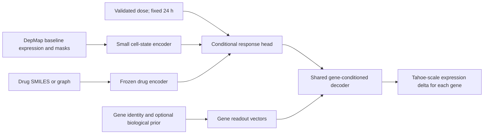

# Virtual-cell perturbation generalization: encoders, evidence and a testable design

Date: 2026-09-14. Status: literature review and proposed experimental design;
no model fitting, feature extraction, new data acquisition or Slurm submission.

This review extends the consultation in
[`../report/09_11_record.md`, section 21](../report/09_11_record.md#21-2026-09-14-architecture-consultation-virtual-cell-encoders).
The new emphasis is deployment from **DepMap baseline alone**, alongside
separate unseen-drug and unseen-environment questions. This deployment
assumption is our interpretation of the user's proposal, not a newly measured
capability. The earlier DMSO-available benchmark remains a separate task.

## 1. Assessment / 判断

**有研究价值，三编码器路线也有直接先例。最值得检验的核心是：定量的细胞
基线是否能支持跨细胞系的、药物特异的响应预测；encoder 数量和拼接本身不构成
新的科学贡献。** 文本、蛋白序列和知识图谱可以提供先验，但预训练任务与
表达变化预测之间的迁移必须实测。

The existing negative result is narrow: a particular reference-only
DepMap-expression linear correction did not stably improve an already strong
Tahoe-DMSO-conditioned predictor. It does not establish that nonlinear
DepMap-only prediction is impossible. Conversely, that possibility does not
establish that a larger model will succeed.

Our completed standalone DepMap ridge already contains signal: drug-residual
Pearson 0.208719 on 23 held-out lines. The failed complementarity test changes
Rhaister-O from 0.539430 to 0.539787, with paired line-bootstrap improvement
interval [-0.002679, 0.003610]. These use a different information set from a
DepMap-only deployment experiment. See
[`ORDERED_BASELINE_EXPERIMENTS.md`](ORDERED_BASELINE_EXPERIMENTS.md).

## 2. Specify what is observed at deployment

| Task | Target-line information available | Meaningful comparison |
|---|---|---|
| Existing strict Tahoe line holdout | Tahoe DMSO; optional external DepMap | Frozen Rhaister-O and same-input corrections |
| Proposed DepMap-only line holdout | DepMap untreated expression; declared metadata; no target Tahoe DMSO input | Drug-dose mean, existing DepMap ridge, compact conditional predictor, optional cross-fitted pseudo-DMSO bridge |
| Unseen drug | Structure and optionally externally established target/MOA annotations; no held-out drug response labels | Chemistry-conditioned baselines and candidate on identical splits |
| Joint new line + new drug | Both restrictions simultaneously | Models that can encode both entities inductively |

Rhaister-O can be shown as a **richer-input reference**, not an equal-input
competitor or a mathematical upper bound, when target Tahoe DMSO is absent.
Its treatment-specific learned coefficients also make it unsuitable as an
unchanged baseline for a completely unseen drug.

Target-line Tahoe DMSO may still be used by the **evaluator** to construct the
ground-truth delta. It must not enter the model, its bridge, preprocessing,
early stopping or hyperparameter selection in the DepMap-only task.

Practical zero-shot means no target-line treatment labels. Allowing the target
baseline during unsupervised pretraining is a separate choice: report it as
target-identity-transductive. A strict sensitivity excludes target-line
baseline rows from fitting too and only encodes them at inference. Frozen
pretrained models need their own data provenance audit; unknown exposure must
not be reported as verified absence.

## 3. Closest architectural precedents

These are literature findings, not local reproductions. Published OOD claims
are recorded at their own data and information boundaries.

| Work | Relevant design / evidence | Boundary for our project |
|---|---|---|
| [MultiDCP, PLOS Computational Biology 2022](https://journals.plos.org/ploscompbiol/article?id=10.1371/journal.pcbi.1010367) | Chemical graph, gene-network features, quantitative baseline-expression encoder and dose representations are concatenated. Reports leave-new-line-out prediction on L1000 with external baseline RNA-seq. | Very close to the proposed encoder layout. S10 explicitly describes distinct train/dev/test lines for response and autoencoder tasks. Exact cross-module fold alignment and earlier batch harmonization were not code-audited here. Not a Tahoe/Rhaister reproduction. |
| [XPert, Nature Machine Intelligence 2026](https://www.nature.com/articles/s42256-025-01165-w) | Baseline gene tokens, UniMol chemistry, drug–target/PPI graph features and dose/time conditioning; explicitly evaluates cold-cell and cold-drug splits and expression deltas. | Uses matched baseline input and 978 L1000 landmarks. No demonstrated DepMap-only Tahoe or Rhaister-residual superiority. Reported protocol has not been independently code-audited here. |
| [TxPert, Nature Biotechnology 2026](https://www.nature.com/articles/s41587-026-03113-4) | Combines basal state and graph-derived perturbation representations; evaluates unseen genetic perturbations and whole-line holdouts. | Genetic perturbations, not chemical-drug transfer. Target controls are available; some strongest graph inputs are proprietary. |
| [chemCPA, NeurIPS 2022](https://proceedings.neurips.cc/paper_files/paper/2022/hash/aa933b5abc1be30baece1d230ec575a7-Abstract.html) | Chemistry-conditioned compositional perturbation representation supports held-out compounds. | Unseen compounds and unseen cell identities are different tests; encoding chemistry alone does not demonstrate joint transfer. |
| [PrePR-CT, Nature Machine Intelligence 2026](https://www.nature.com/articles/s42256-026-01202-2) | Derives context-specific gene graphs from untreated cells; evaluates held-out contexts and perturbations. | A single bulk vector cannot supply a within-context cell–cell sampling distribution for estimating such a graph. Its cross-dataset Tahoe comparison also exposes limits when target controls are unavailable. |
| [GEARS, Nature Biotechnology 2023](https://www.nature.com/articles/s41587-023-01905-6) | Biological graph priors for unseen genetic interventions and combinations. | A perturbed gene node is an intervention; an output gene is a readout. Chemical inhibition cannot be assumed equivalent to knocking out its target. |
| [MAP, Nature Machine Intelligence 2026](https://www.nature.com/articles/s42256-026-01286-w) | Multimodal chemical, protein and mechanistic-text representations; separate held-out-drug protocol with KG filtering. | Its Tahoe context experiment is a line–drug pair split, not complete-line holdout. Frozen transcriptome-encoder pretraining needs a separate audit. |
| State / Tahoe-x1 / Rhaister-O | Existing primary task comparators; local split audit and baseline reproduction are available. | Keep the established strict-line versus few-shot distinctions. See [`../papers/README.md`](../papers/README.md); State's newer Cell publication is a different version from the local v2 PDF. |

The sequence **MultiDCP → XPert → cell representation papers → TxPert /
PrePR-CT → our frozen baseline audit** gives the shortest useful reading path.

## 4. What each encoder should encode

### Drug: molecular identity plus experimentally relevant conditions

Use validated SMILES or a molecular graph, preserving stereochemistry and
declaring salt handling. A molecular formula only counts atoms and cannot
distinguish all structural isomers. A frozen chemical encoder is reasonable;
compare it against a simple fingerprint on the same split. UniMol provides a
concrete structure-based option, rather than evidence that a large encoder
will necessarily beat fingerprints. [Official UniMol repository](https://github.com/deepmodeling/Uni-Mol).

Encode dose explicitly in validated units. Tahoe's three positive doses can
use log10(dose in µM); DMSO/zero-dose controls need a separate control indicator
and cannot be sent through log10(0). Time is fixed at 24 h in the present
benchmark, so Tahoe alone does not identify a general time-response function.

Known targets/MOA can supplement chemistry. Distinguish **chemistry-only
unseen drug** from **target-informed unseen drug**. A compound unseen in the
response training set may still be described in public target databases;
that is useful external knowledge, not proof of de novo target discovery.

### Gene: output identity and biological prior

For chemical Tahoe prediction, gene g is normally an **output readout**, not
the intervention. Every condition has a collection of gene vectors q_g, not
one gene vector standing for the whole transcriptome.

ESM-2 produces protein-sequence representations; it does not model the
amount of transcript produced by a cell. A canonical protein sequence gives
the same prior across cell lines unless variants/isoforms are supplied.
AlphaFold predicts molecular structure and requires a separate structural
representation if used here. Neither supplies an inverse decoder from a
cell-response latent to expression.
[ESM-2 author repository](https://github.com/facebookresearch/esm),
[AlphaFold author repository](https://github.com/google-deepmind/alphafold).

For a fixed 2,000-gene output panel, first compare learned gene readouts with
GO/pathway/PPI priors. Protein embeddings are a later prior ablation, with
explicit symbol–protein–isoform mappings and a missing-feature policy. A
static embedding by itself cannot express cell-specific regulation. An
unseen-output-gene test is an additional task and is not required to test
unseen drugs or cell contexts.

### Cell: measured state, optionally augmented by identity metadata

The input should represent what the cell is like before treatment, not just
which catalogue line it belongs to. A learned lookup keyed by cell-line name
has no principled vector for a new line.

For the current deployment assumption, start with DepMap expression and
missingness masks. Compare a reference-only PCA/ridge control with a small
expression/pathway encoder. Pretraining a compact encoder on a broader
baseline collection is a hypothesis worth testing; observational
reconstruction alone does not establish drug-response sufficiency.

CNV/mutations and external functional assays have different acquisition
requirements and can be added individually if selected later. Chronos
dependency is an external CRISPR perturbation assay, not an untreated RNA
measurement. Keep the input budget explicit rather than calling every
DepMap modality an untreated baseline.

Text can encode tissue, histology and declared baseline molecular annotations.
If the text is deterministically generated from the same structured features,
it adds no new measured sample information; it changes the representation and
introduces the language model's prior. Compare identical facts as structured
features versus text, omit catalogue names in the primary text ablation, and
exclude response/resistance claims about evaluation drugs. Wider literature
text is an additional data source whose provenance must be audited.

SapBERT's biomedical synonym/entity alignment objective is relevant to naming
and entity resolution, but is not a validated objective for encoding
quantitative response state. Frozen use is the appropriate initial ablation;
fine-tuning a large text model on about 45 response-labelled contexts per fold
has little direct justification.
[SapBERT, NAACL 2021](https://aclanthology.org/2021.naacl-main.334/).

### Cell-encoder alternatives worth comparing

| Candidate | What the source establishes | Role and caveat |
|---|---|---|
| Small expression/PCA encoder | Our existing reference-only ridge has measured residual signal; see the local ordered baseline report. | Mandatory inexpensive control; a nonlinear bottleneck is a new experiment. |
| Fixed pathway features | [PROGENy](https://www.nature.com/articles/s41467-017-02391-6) estimates pathway footprints from expression. | Interpretable features; pathway-member expression is not equivalent to pathway activity. PROGENy uses perturbation-derived priors, whose source boundary needs checking. |
| [CellWhisperer, Nature Biotechnology 2025](https://www.nature.com/articles/s41587-025-02857-9) / [author code](https://github.com/epigen/CellWhisperer) | Joint transcriptome–text learning using bulk/single-cell expression and descriptions. | More closely matched to text–expression alignment than entity linking; search/annotation/chat performance is not held-out perturbation performance. |
| [LangCell, ICML 2024](https://proceedings.mlr.press/v235/zhao24u.html) | Cell–language pretraining for cell identity understanding. | Relevant frozen text/cell representation; annotation zero-shot does not establish response zero-shot. Bulk transfer is untested here. |
| [Geneformer v1, Nature 2023](https://www.nature.com/articles/s41586-023-06139-9) and [scGPT, Nature Methods 2024](https://www.nature.com/articles/s41592-024-02201-0) | Pretrained expression representations with downstream adaptations. | Candidate features; honor vocabulary, ranking/binning and checkpoint-specific provenance. Single-cell pretraining does not guarantee calibrated bulk input. |
| [scFoundation, Nature Methods 2024](https://www.nature.com/articles/s41592-024-02305-7) / [author code](https://github.com/biomap-research/scFoundation) | Official code includes bulk embeddings for DeepCDR and SCAD. | Practical frozen bulk-input candidate. IC50/sensitivity applications do not validate Tahoe expression deltas. |
| [BulkFormer, Cell Systems 2026](https://doi.org/10.1016/j.cels.2026.101657) / [author code](https://github.com/KangBoming/BulkFormer) | Bulk-transcriptome pretraining. The repository removes its former LINCS compound-perturbation benchmark because L1000 differs from bulk RNA-seq. | Bulk-oriented candidate with a useful negative scope correction; not proven L1000/Tahoe response transfer. |

Bulk-input support is feasibility, not calibration. Ranking or binning can
discard amplitude information; keep a quantitative expression control. The
mean of individual-cell embeddings is generally different from the embedding
of a mean profile under a nonlinear encoder. A single DepMap bulk row cannot
estimate within-line gene coexpression without additional replicate/cell data.
A fixed external graph or reference-fitted graph with cell-specific node
values is a separate feasible design.

## 5. A coherent minimal architecture

One possible parameterization is:

\[
z_c=E_c(x_c^{\mathrm{DepMap}},m_c),\quad
z_p=E_p(\mathrm{SMILES}_p),\quad q_g=E_g(a_g),
\]
\[
h_{c,p,d}=F(z_c,z_p,\log_{10}d),\qquad
\widehat{\Delta}_{c,p,d,g}=D(h_{c,p,d},q_g).
\]

Here a_g denotes the selected gene features. D is trained on the Tahoe
response target; it is not a protein-language-model decoder. A low-rank
version uses q_g^T h plus a gene-specific intercept; a slightly richer version
uses a small shared MLP of h and q_g. The simpler version tests whether
sharing statistical strength across drugs and genes helps.

**Concatenation does not require equal feature dimensions.** Separate learned
projections and normalization may help optimization; equal vector length
does not align independently pretrained semantic spaces. Start with a small
concatenation head and a capacity-comparable bilinear/gated interaction
control. There is no evidence here that attention must beat those controls.

Prefer supervision in the original delta space. If an explicit response
autoencoder supplies the latent target, fit it solely on training/reference
responses, inspect validation reconstruction, and retain a decoded delta
loss. A latent MSE by itself can reward an embedding that loses treatment
signal. A deterministic latent regressor predicts a conditional point
estimate; it does not establish single-cell distributional generation.

The target is a **Tahoe-scale treated-minus-matched-control expression delta**.
Do not add that delta numerically to raw DepMap log-TPM to claim absolute
post-treatment expression. That requires a separately validated assay-space
bridge or baseline decoder. A direct DepMap-to-delta model can be evaluated
without such an absolute-expression reconstruction.

## 6. Where a knowledge graph helps—and what it does not show

A useful candidate links drug targets to protein/pathway/regulatory structure
and then conditions those links on the measured cell state. Static PPI/GO
information alone does not specify which pathway is active in a particular
line. Coexpression, physical interaction and signed regulation are distinct
edge meanings; attention weights and graph paths are not causal validation.

Freeze graph versions and source types. Exclude edges derived from held-out
drug-response outcomes. If an unseen entity already appears in an external
graph, declare that information; a fixed node lookup will not automatically
handle an entirely new graph node. Include no-graph and degree-preserving
rewired-graph controls before attributing an improvement to biological
knowledge. The added graph is optional to the first encoder test.

## 7. Keep generalization axes separate

| Axis | Required split / information rule | Interpretation |
|---|---|---|
| New line, known drug | Hold out all target-line treatments before fitting any response-derived transform | Primary first experiment; maintain the 23 expression-covered held-out lines and explicit missing cases |
| New drug, known lines | Hold out a compound at all doses and all lines; group duplicates/salts before splitting | Chemistry generalization; add scaffold/structure-cluster split as a harder sensitivity |
| New line and new drug | Training excludes every held-out line and every held-out drug; final test is their intersection | Joint OOD; separate score and nested entity-level validation |
| New environment | Train across measured environments; hold out an environment while controlling entity overlap | Cannot be established merely by adding an environment embedding |

Drug identity holdout is easier than a novel-chemotype holdout. Holding out a
dose of a drug is not holding out the drug. Chemical interventions and unseen
CRISPR targets require different encoders and supervision.

Define environment operationally: culture medium, oxygen, coculture or
exposure history can modify biology; library platform/laboratory/batch can
modify the observation. A dataset indicator cannot disentangle both. With
only one dominant culture protocol and a single time point, arbitrary
environment effects are not identifiable from Tahoe. Plate-6/14 repetition
helps assay reproducibility but is not broad environment generalization.

For now, condition the scientific claim on Tahoe-like assay conditions.
Cross-dataset tests are measured distribution shifts, not a demonstrated
environmental mechanism. L1000's weak 79-landmark concordance in our data
remains an empirical constraint, not an interchangeable training target.

## 8. Proposed first experiment and decision criteria

This is a concrete design for review, not an executed or approved training
protocol. It changes the question from correcting a DMSO model to predicting
from independently available baseline inputs.

1. Freeze the **DepMap-only, known-drug, new-cell-line** information boundary,
   existing fixed-2K target and complete-line outer splits. Include the
   existing drug-mean and DepMap ridge as equal-input baselines. Show DMSO
   Rhaister-O separately as a richer-input reference.
2. With one fixed simple drug representation and decoder, compare PCA,
   compact expression encoder and a pathway-feature alternative. Compare a
   small concatenation MLP to bilinear conditioning; do not combine all
   architectural choices into a single winning-or-losing bundle.
3. Test cell information with a drug-only predictor and line-block feature
   permutation. Test structured metadata versus frozen text of exactly those
   metadata, and then expression plus metadata/text. Similar clusters or
   attractive embedding plots are not the endpoint.
4. Only after the context choice is fixed, compare fingerprint versus frozen
   pretrained drug embedding, learned gene readout versus graph/function
   prior, and optionally ESM-2. Treat these as separate additions.
5. Freeze the chosen configuration using inner whole-line validation before
   reporting outer results. Fit PCA, response bases, normalization and
   pseudo-DMSO bridges anew inside every relevant fold. The already viewed
   outer benchmark is retrospective; do not call new tuning on its outcomes
   prospective confirmation.

Primary evidence should include drug-mean-residual and reference-template-
removed line-macro Pearson, decoded-delta RMSE, paired uncertainty over lines,
and drug-cluster uncertainty with doses grouped. Use the same measured
conditions across comparisons. Require a predeclared practically meaningful
gain over the best **equal-input** baseline, an improvement interval above
zero, no material error degradation, and a context-shuffling control that
removes the claimed context benefit. These are proposed criteria; no numerical
new gate is declared approved here. The old Rhaister-complementarity gate
cannot be silently reused as if it tested DepMap-only utility.

Only 50 Tahoe response-labelled lines exist (45 reference lines in each
released split, fewer with DepMap expression). Millions of cells and many
gene readouts do not supply millions of independent cell contexts. Larger
baseline pretraining can help representation learning, but does not create
new drug-by-context response labels. This is the main reason for frozen
external encoders and small trainable heads initially.

Code/weights, dataset availability and leakage must be audited before a
reproduction is scheduled. All feature extraction and model training belong
in monitored Slurm allocations under the existing HPC policy.

## 9. Review provenance and limits

Two user-requested subagents supplied independent evidence notes:
`virtual_cell_literature` (gpt-5.6-terra, high) and `cell_context_design`
(gpt-6-astra, xhigh). The primary agent checked architecture sources and
resolved a disagreement using MultiDCP's S10 caption: the paper does describe
separate line partitions for both tasks. That should not be replaced by an
unsupported assumption that all target baselines were used for fitting.

This review accessed primary papers, author repositories and existing local
reports. Some publisher pages were partly inaccessible; repository support
or abstracts establish only the scope stated above. We did not reproduce
these papers, download model weights, or verify every preprocessing step in
their code. Proposed designs, published evidence and measured Therapeutic
results are distinguished throughout.
